<p align="center"></p>
<h1 align="center">Carpediem</h1>
<p align="center">A volunteer and event staffing workspace for administrators, chief leaders, and leaders.</p>
<p align="center">
  <a href="#quick-start">Quick start</a> · <a href="#application-preview">Preview</a> · <a href="#workflow-recordings">Recordings</a> · <a href="#testing">Testing</a> · <a href="#documentation">Documentation</a>
</p>

Carpediem brings event planning, staffing, attendance and follow-up into one role-aware application. The latest interface refresh puts the next action first: administrators work from a date-grouped operations dashboard, chief leaders manage people and attendance, and leaders can respond to an event with its schedule and venue in view.

## Quick start

On Windows, start Docker Desktop and run this from the repository root in PowerShell:

```powershell
.\start.ps1
```

The script builds and starts SQL Server, runs the migration service, and starts the API and frontend. Open **https://localhost:8443** and accept the warning for the local self-signed certificate. The first build can take several minutes. If `.env` is missing, the script creates it with local development credentials; an existing file is left unchanged. SQL data persists across restarts.

```powershell
docker compose --profile stack logs -f  # inspect startup or errors
docker compose --profile stack down     # stop the stack
```

The [transformation report](docs/ux/transformation/FINAL-REPORT.md) records SQL errors with the stock Compose migrator's default session options during an earlier local setup. If migrations fail, check the logs; a successful build alone does not establish that the app is ready.

Development accounts include `admin`, `chief.one`, `chief.two`, and `leader.one` through `leader.five`. For a newly created `.env`, their seed password is `Carpediem#2026SeedAdmin!`. Existing environment settings and database accounts may differ.

## Application preview

### Desktop workspace

| Operations | Team selection |
| --- | --- |
| 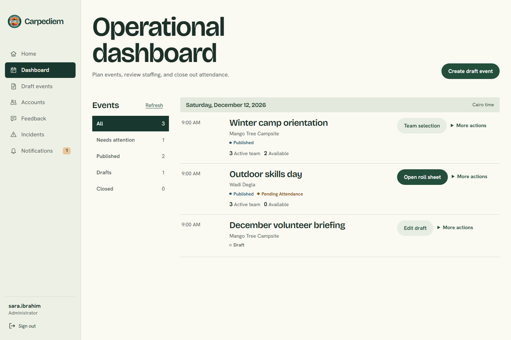 | 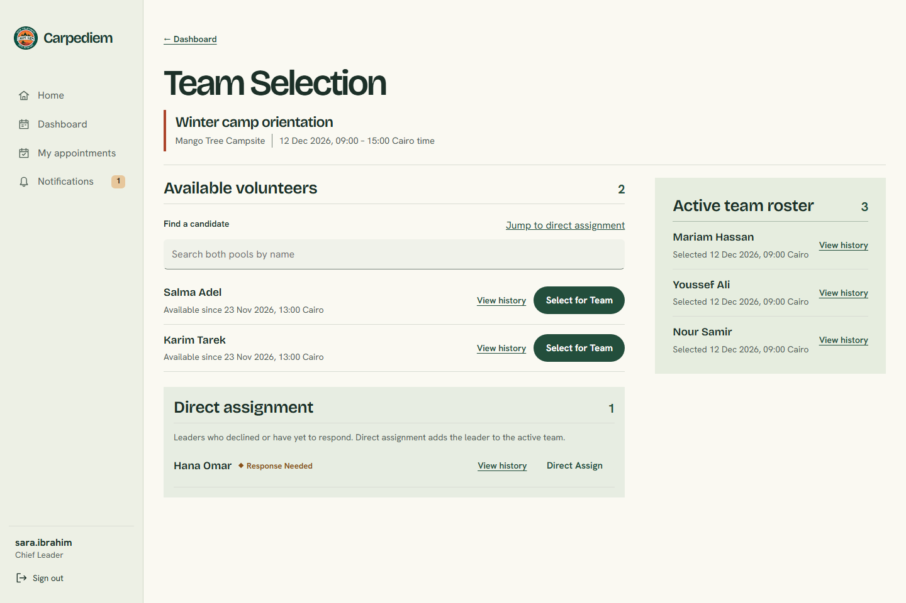 |
| Date-grouped events and actions. | Staffing pools and roster management. |

| Attendance | Welcome |
| --- | --- |
| 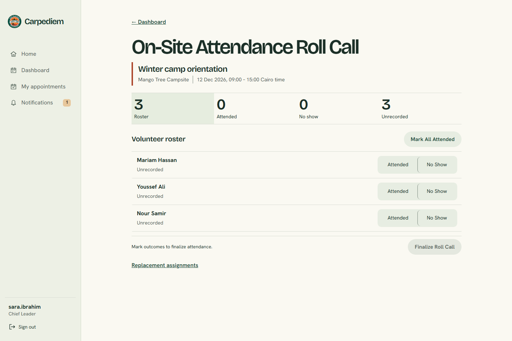 | 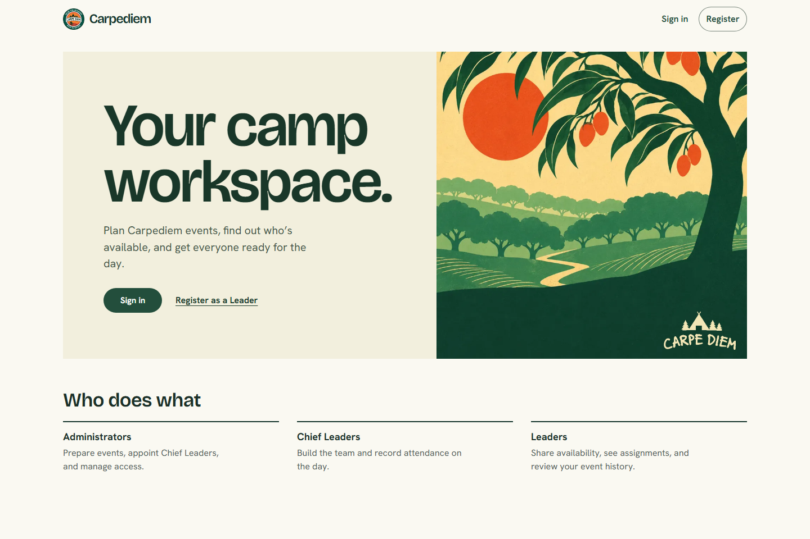 |

### Mobile records

| Availability | Appointment | Assignment |
| --- | --- | --- |
| 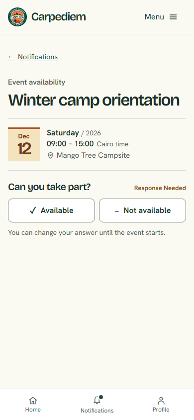 | 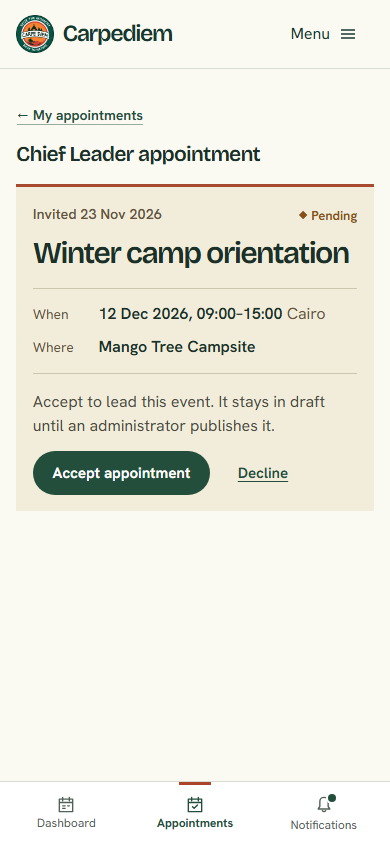 | 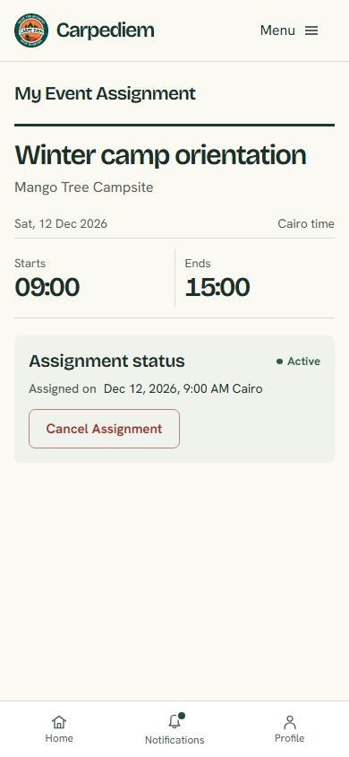 |

| Feedback | Incident report | Operations |
| --- | --- | --- |
| 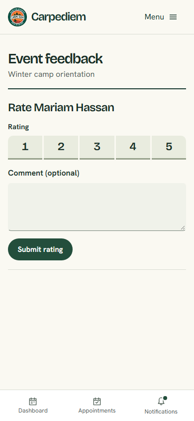 | 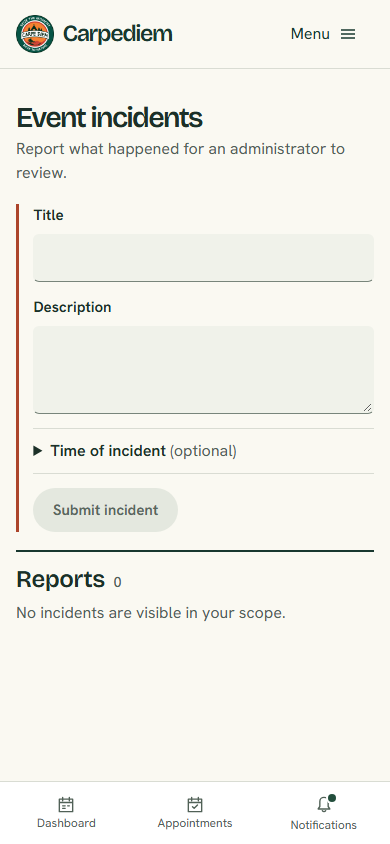 | 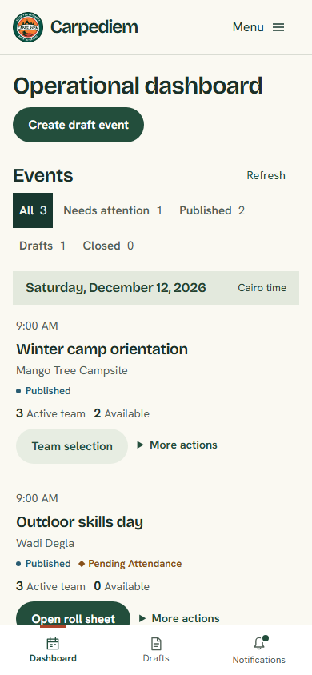 |

These captures use synthetic fixtures. See the [page comparisons](docs/ux/excellence/PAGE-REVIEW.md), [mobile record review](docs/ux/excellence/mobile-records/INDEPENDENT-REVIEW.md), and [earlier screenshot inventory](docs/screenshots/README.md) for more screens and context.

## Workflow recordings

The latest recordings use synthetic identities and deterministic API responses; some requests are deliberately delayed to show pending states. The [verification report](docs/ux/excellence/VERIFICATION.md) describes their scope and reproduction.

| Workflow | Recording |
| --- | --- |
| Account access | [Registration and sign-in](docs/ux/excellence/public/recordings/registration-and-sign-in.webm) |
| Navigation | [Mobile navigation and focus return](docs/ux/excellence/recordings/mobile-navigation.webm) |
| Event planning | [Draft validation](docs/ux/excellence/recordings/draft-validation.webm) |
| Chief leader | [Appointment acceptance](docs/ux/excellence/recordings/appointment-acceptance.webm) · [Linked replacement](docs/ux/excellence/recordings/linked-replacement.webm) · [Attendance finalization](docs/ux/excellence/recordings/attendance-finalization.webm) |
| Leader | [Availability response](docs/ux/excellence/recordings/availability-response.webm) · [Delayed response and recovery](docs/ux/excellence/mobile-records/independent/delayed-response.webm) |

The earlier [full product demo](https://drive.google.com/file/d/14rN_o3YPcDIsb1KE0zNQxaUlDLOZueM8/view?usp=sharing) and its [production notes](docs/demo/production-notes.md) remain available; it predates the latest interface refresh.

## Capabilities

- **Administrators:** create and publish events, appoint chief leaders, manage accounts, review feedback and incidents, and oversee event closeout.
- **Chief leaders:** respond to appointments, select a team, manage replacements, record attendance, and submit feedback or incident reports.
- **Leaders:** respond to availability, review assignments, receive notifications, and view participation history.

The latest review documents limitations including narrow overnight schedules, field-device and human screen-reader testing still outstanding, and the replacement API's inability to indicate an older cancellation linked in another session. See the [design excellence report](docs/ux/excellence/FINAL-REPORT.md) for details.

## Architecture and stack

The Angular 22 frontend communicates with an ASP.NET Core 10 API. The backend is a modular monolith with Identity, Events, Staffing, Attendance, and Notifications modules, backed by EF Core and SQL Server. The local container stack serves the frontend and API through an HTTPS reverse proxy.

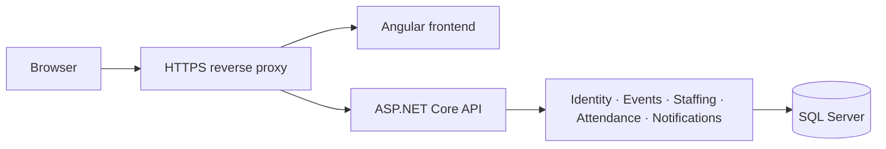

The frontend uses TypeScript, SCSS, self-hosted Bricolage Grotesque and Hanken Grotesk fonts, semantic design tokens, and reduced-motion support. The [asset inventory](docs/ux/transformation/ASSET-INVENTORY.md) and [public design notes](docs/ux/excellence/public/PUBLIC-DESIGN.md) describe the brand artwork and asset decisions. Campsite photography and footage remain subject to the restrictions recorded there.

## Testing

The [verification report](docs/ux/excellence/VERIFICATION.md) records the 26 November 2026 review: a successful production build, 104 Angular tests, 430 Playwright cases and 184 SQL integration tests; an earlier run recorded 96 domain tests. The mobile record review covered seven routes at eight widths and includes keyboard and automated accessibility checks. These are historical results, not a claim that the current working tree has been retested. Physical devices, human screen-reader use and production latency remain unverified.

```powershell
# Domain tests
dotnet test tests/Carpediem.Domain.Tests/Carpediem.Domain.Tests.csproj

# SQL-backed API integration tests
powershell -File tests/run-sql-integration.ps1

# Frontend tests and production build
cd frontend
npm ci
npx ng test --watch=false
npm run build

# End-to-end tests (from the repository root)
cd ../tests/e2e
npm ci
npx playwright test
```

See [testing documentation](docs/testing/README.md) and the [verification report](docs/ux/excellence/VERIFICATION.md) for setup and evidence.

## Documentation

- [Latest UI report](docs/ux/excellence/FINAL-REPORT.md) · [Page review](docs/ux/excellence/PAGE-REVIEW.md) · [Components and motion](docs/ux/excellence/COMPONENTS-AND-MOTION.md)
- [Design transformation](docs/ux/transformation/FINAL-REPORT.md) · [Design system](docs/ux/transformation/DESIGN-SYSTEM.md) · [Asset inventory](docs/ux/transformation/ASSET-INVENTORY.md)
- [Architecture and module boundaries](docs/architecture/MODULE_BOUNDARIES.md) · [Lifecycle specification](docs/requirements/LIFECYCLE_SPECIFICATION.md) · [Role permissions](docs/requirements/ROLE_PERMISSION_MATRIX.md)
- [V1 implementation status](docs/roadmap/V1_IMPLEMENTATION_STATUS.md) · [Deployment guide](docs/deployment/VERCEL_MONSTERASP_SQL.md) · [Documentation index](docs/README.md)
