# Carpediem

> **Enterprise-grade volunteer and event staffing platform built with Angular 22, ASP.NET Core 10, Entity Framework Core 10, and SQL Server 2025.**

[](https://dotnet.microsoft.com/)
[](https://angular.dev/)
[](https://www.microsoft.com/sql-server)
[](#7-architecture)
[](#phase-2--uiux-refinements)
[](#9-testing)

---

## 1. Project Introduction

**Carpediem** is a dedicated workforce orchestration and volunteer management platform designed for non-profit organizations, large-scale festivals, and community initiatives. Event organizers frequently struggle with fragmented communication across spreadsheets, chat groups, and disconnected calendars—leading to understaffed critical shifts, unconfirmed roles, and high operational churn.

Carpediem solves this by consolidating the entire staffing lifecycle into a unified, responsive platform:
- **Centralized Event Operations**: Real-time event drafting, Chief Leader delegation, and multi-shift monitoring.
- **Roster & Team Formation**: Intelligent role slotting, qualification matching, and automated assignment balancing.
- **On-the-Ground Execution**: Instant check-in roll calls, substitute replacements, and live incident reporting.
- **Volunteer Self-Service**: One-click shift declarations, personal assignment histories, and centralized notifications.

### Target Users & Roles
1. **System Administrators**: Operational managers responsible for planning events, setting staffing requirements, approving user accounts, and monitoring organizational health.
2. **Chief Leaders**: Field commanders responsible for accepting event leadership, forming qualified teams from available volunteers, and overseeing live event check-ins.
3. **Leaders (Volunteers)**: Field staff and specialists who declare shift availability, receive assignment notices, execute shifts, and review their participation.

### Current Implementation Status
All core **V1 Slices (1 through 22)** are fully implemented and verified locally. The platform features 183 SQL integration tests, 96 domain logic tests, 100 Angular component/service tests, and 410 Playwright cross-browser/accessibility tests across 5 viewports (total **789 / 789 passing tests**) with zero axe-core accessibility violations, zero horizontal overflows down to 320px, and zero SCSS bundle budget warnings.

---

## 2. Product Overview

Carpediem manages the progression of an event through well-defined lifecycle states:

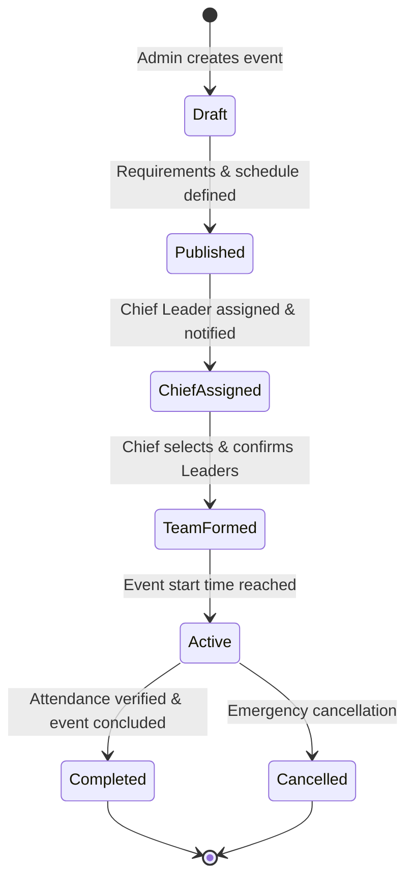

### Distinguishing Implemented vs. Planned Capabilities

| Functional Area | Fully Implemented (V1) | Planned / Future Roadmap (V2) |
| :--- | :--- | :--- |
| **Authentication & Accounts** | Cookie session auth, CSRF tokens, self-registration, admin role approvals. | Multi-factor authentication (MFA), OAuth2 / OpenID Connect single sign-on. |
| **Event Planning** | Multi-role requirements, scheduling, Chief assignment, draft editing. | Recurring event templates, automated seasonal calendar imports. |
| **Team Selection** | Qualifications matching, slot assignment, roster lock, replacement workflow. | AI-driven leader ranking based on historical attendance and commute distance. |
| **Live Attendance** | Real-time roll sheet check-ins, substitution tracking, no-show logging. | Geofenced mobile self-check-in, offline-first PWA sync. |
| **Notifications** | In-app notification center, unread counters, assignment alert broadcasts. | Real-time WebSockets (SignalR), SMS broadcasts, push notifications. |
| **Post-Event** | Event completion dialogs, feedback submissions, incident governance. | Automated hours certification certificates (PDF generation), payroll export. |

---

## 3. Application Preview

### Desktop Experience (`1440 × 900`)

| Operational Management Dashboard | Team Selection & Roster Building |
| :---: | :---: |
| 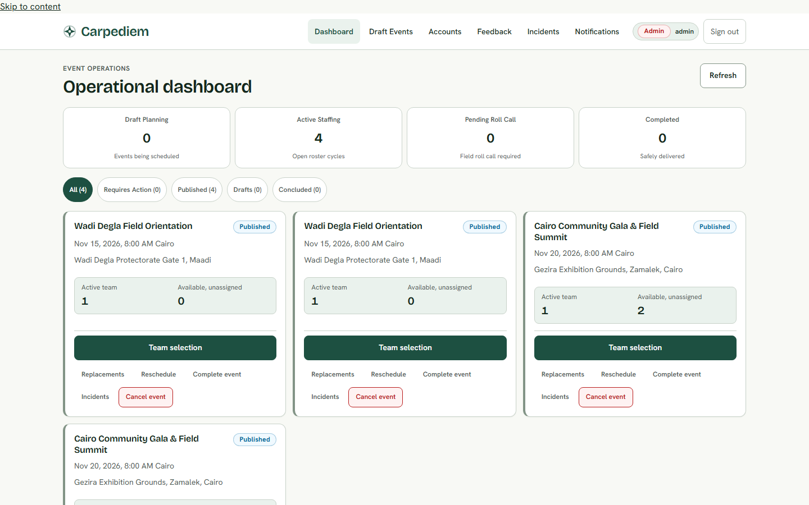 | 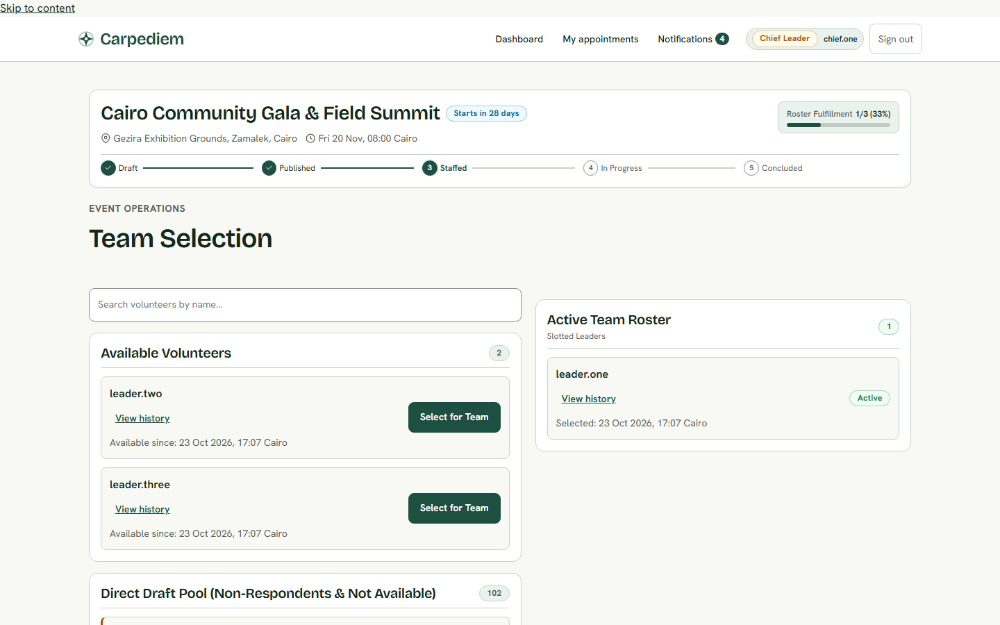 |
| *Real-time metrics, draft event controls, and direct workflow quick actions.* | *Role slotting, qualification verification, and auto-assignment balancing.* |

| Real-Time Attendance Roll Call | Leader Availability Declaration |
| :---: | :---: |
| 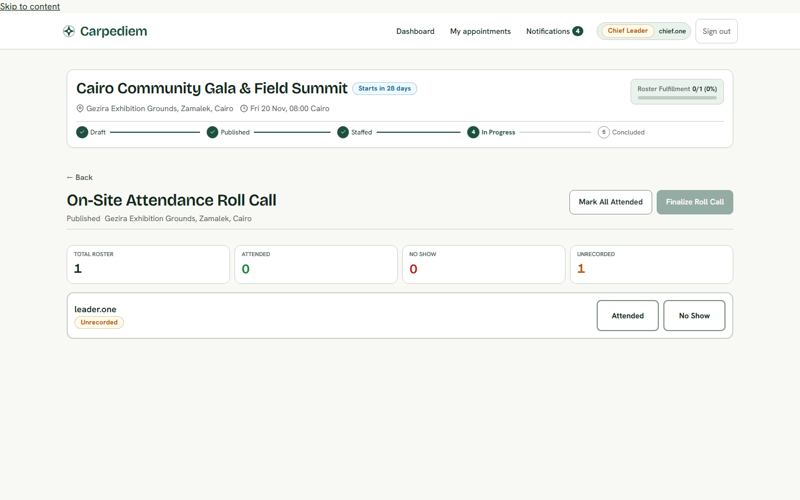 | 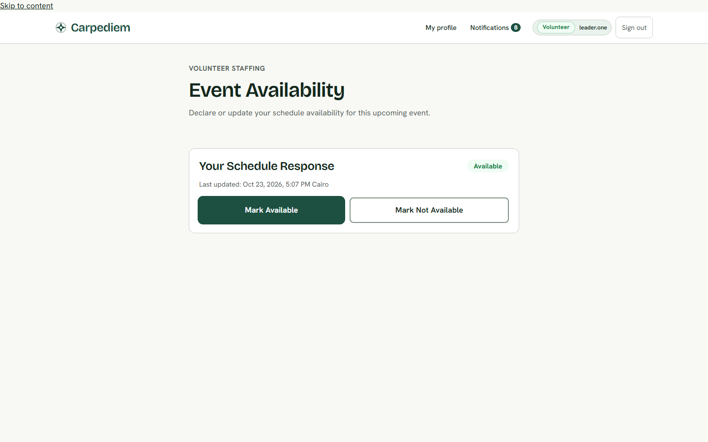 |
| *Live check-in toggles, substitute assignment, and attendance verification.* | *Intuitive shift availability calendar and preferences declaration.* |

### Mobile Experience (`390 × 844`)

| Leader Availability | Administrative Operations | Chief Team Roster |
| :---: | :---: | :---: |
| 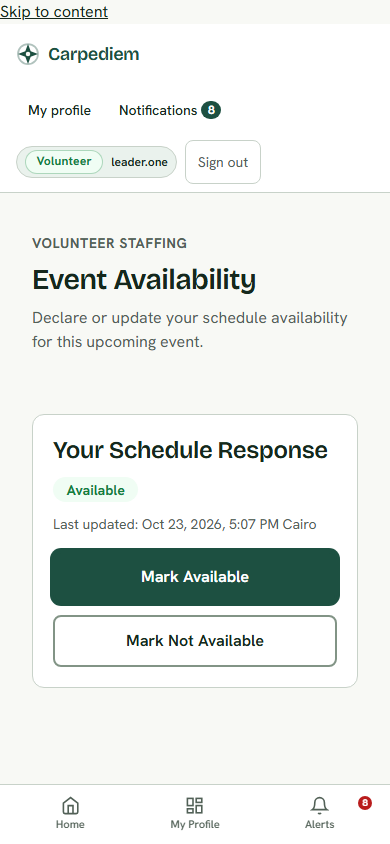 | 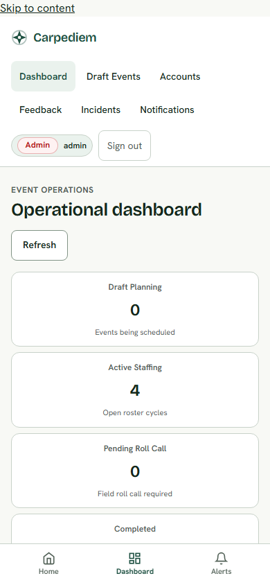 | 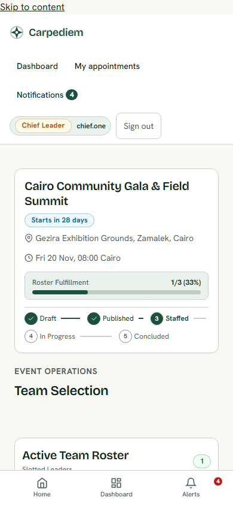 |
| *Fluid touch targets ($\ge 44\text{px}$) with zero horizontal scroll.* | *Immediate operational metrics and quick management actions.* | *Responsive role cards adapted for on-the-ground coordination.* |

---

## 4. Product Demo Video

Experience the complete Carpediem end-to-end workflow—from event creation and Chief Leader delegation to team formation, live attendance roll call, and post-event incident governance—in this 2-minute Full HD walk-through:

[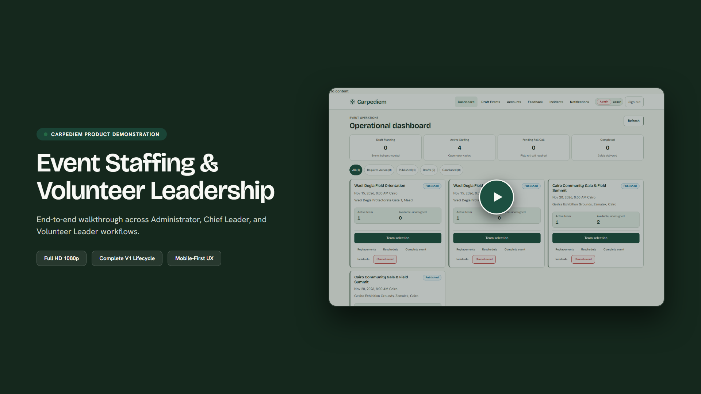](docs/demo/carpediem-product-demo.mp4)

> 📹 **[Watch the Full HD Video Demo (`docs/demo/carpediem-product-demo.mp4`)](docs/demo/carpediem-product-demo.mp4)**  
> *Recorded in 1080p @ 30fps with synchronized captions and zero artificial mockups.*  
> Comprehensive production notes and scene scripts are available in [`docs/demo/production-notes.md`](docs/demo/production-notes.md) and [`docs/demo/storyboard.md`](docs/demo/storyboard.md).

---

## 5. Features by Role

### 👑 Administrator Capabilities
- **Operational Dashboard**: High-level KPI summary cards displaying Draft, Published, Active, and Completed events with one-click contextual action links.
- **Event Lifecycle Administration**: Formulate draft events, define role quantities, set venue/schedule windows, reschedule dates, and execute emergency cancellations.
- **Account Governance**: Review pending user registrations, verify contact details, assign role permissions, and activate volunteer accounts.
- **Incident Oversight**: Review field incident reports submitted by Chief Leaders, triage severity, and record resolution notes.
- **Post-Event Completion**: Formally verify shift records and mark events completed to finalize hours.

### 🛡️ Chief Leader Capabilities
- **Assignment Response**: Receive event leadership invitations, inspect full event staffing criteria, and formally accept or decline leadership.
- **Team Selection & Roster Management**: Browse pool of qualified leaders who declared availability, assign them to specific roles, view real-time fulfillment percentages, and lock final rosters.
- **Emergency Replacement Assignment**: Replace no-show or withdrawn leaders with qualified substitutes even after the roster has closed.
- **Live Attendance Roll Sheet**: Conduct real-time check-ins at the venue, mark attendees Present or Absent, designate replacements on the fly, and verify the roll call.
- **Event Feedback & Debrief**: Submit quantitative ratings and qualitative operational feedback following event conclusion.

### 👤 Leader (Volunteer) Capabilities
- **Availability Management**: Declare shift availability for upcoming published events with custom notes.
- **Notification Inbox**: Receive automated in-app alerts for event invitations, roster confirmations, schedule changes, and replacements.
- **Assignment History**: Review personal history of completed events, total logged volunteer hours, and attendance reliability records.
- **Profile Self-Service**: Maintain personal contact details, emergency information, and qualified skill sets.

---

## 6. Technology Stack

### Frontend Architecture
- **Framework**: [Angular 22](https://angular.dev/) (Standalone Components, Signals, `linkedSignal`, `resource`)
- **Language**: TypeScript 5.8
- **UI & Layout**: Custom semantic SCSS with design tokens; [Angular CDK](https://material.angular.io/cdk/categories) for overlays and dialogs.
- **Typography**: Variable open fonts (`Bricolage Grotesque` for display headings, `Hanken Grotesk` for body UI).
- **Accessibility**: Full WCAG 2.2 AA compliance audited via Axe-core, adhering to minimum $44\times44\text{px}$ touch targets and semantic landmarks.

### Backend Architecture
- **Framework**: [ASP.NET Core 10](https://learn.microsoft.com/aspnet/core/) (.NET 10 LTS, C# 14)
- **Architecture Pattern**: Modular Monolith with Domain-Driven Design (DDD) principles.
- **Data Persistence**: [Entity Framework Core 10](https://learn.microsoft.com/ef/core/) with SQL Server provider.
- **Database**: Microsoft SQL Server 2025 (tested with Linux container image `mcr.microsoft.com/mssql/server:2025-latest`).
- **Security**: Cookie-based authentication, anti-forgery CSRF protection, secure HTTP headers, and strict endpoint authorization policies.

### Quality & Tooling Infrastructure
- **Browser Automation**: [Playwright](https://playwright.dev/) for cross-browser end-to-end and accessibility testing.
- **Media Pipeline**: Headless Chromium + [FFmpeg 8](https://ffmpeg.org/) for automated 1080p demonstration video generation.
- **Backend Testing**: [xUnit](https://xunit.net/), [Respawn](https://github.com/jbogard/Respawn) for fast database resets, `Microsoft.AspNetCore.Mvc.Testing`.

---

## 7. Architecture

Carpediem is engineered as a **Modular Monolith**, maximizing development velocity and simplicity while enforcing clean architectural boundaries between distinct business domains:

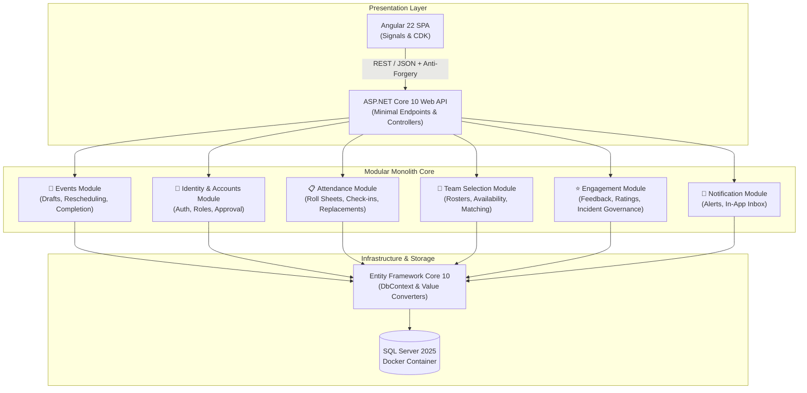

### Module Boundaries
- **Carpediem.Domain**: Pure business entities, aggregates, value objects, and domain invariants with zero third-party dependencies.
- **Carpediem.Infrastructure**: Database migrations, EF Core mappings, password hashing, and repository implementations.
- **Carpediem.Web**: API endpoints, middleware pipeline, authentication, and HTTP contract validation.
- **Carpediem.Frontend**: Standalone Angular components organized by feature modules with centralized state signals.

---

## 8. Running Locally

Follow these instructions to run the complete Carpediem platform locally in development mode.

### Prerequisites
- **.NET SDK**: `10.0.100` or higher ([Download .NET](https://dotnet.microsoft.com/download))
- **Node.js**: `v20.x` or `v22.x` ([Download Node.js](https://nodejs.org/))
- **Docker**: Docker Desktop or Docker Engine running with Linux containers ([Download Docker](https://www.docker.com/))
- **Git**: Installed and configured on your system

---

### Step 1: Start the Database Container
Carpediem uses Microsoft SQL Server 2025. Start the local development container:

```bash
docker run -e "ACCEPT_EULA=Y" -e "MSSQL_SA_PASSWORD=Carpediem#2026DevSql!" \
   -p 14333:1433 --name carpediem-sqlserver-1 -d \
   mcr.microsoft.com/mssql/server:2025-latest
```

*Note: Port `14333` is used by default in development to prevent conflicts with existing SQL Server instances.*

---

### Step 2: Apply Database Migrations & Seed Data
Navigate to the repository root and apply the EF Core database migrations:

```bash
dotnet ef database update --project src/Carpediem.Infrastructure/Carpediem.Infrastructure.csproj --startup-project src/Carpediem.Web/Carpediem.Web.csproj
```

The database will automatically seed with default administrative, chief leader, and leader test accounts alongside sample upcoming events.

---

### Step 3: Start the Backend Web API
Run the backend API using the `https` launch profile:

```bash
dotnet run --project src/Carpediem.Web/Carpediem.Web.csproj --launch-profile https
```

- API Base URL: `https://localhost:7076` (and `http://localhost:5024`)
- Swagger UI / OpenAPI Spec: `https://localhost:7076/swagger`

---

### Step 4: Start the Angular Frontend
In a new terminal window, install frontend dependencies and start the Angular development server:

```bash
cd frontend
npm install
npm start
```

- Web Application URL: `http://127.0.0.1:4200/`

---

### Seeded Development Accounts
All development accounts are provisioned with the password: `Carpediem#2026SeedAdmin!`

| Role | Username | Capabilities / Purpose |
| :--- | :--- | :--- |
| **Admin** | `admin` | Full operational control, user approvals, event drafting |
| **Chief Leader** | `chief.one` | Roster selection, attendance roll calls, replacement handling |
| **Chief Leader** | `chief.two` | Secondary chief leader for multi-event testing |
| **Leader** | `leader.one` | Shift availability declaration, notification inbox, feedback |
| **Leader** | `leader.two` .. `leader.five` | Additional pre-seeded volunteer profiles |

---

## 9. Testing & Quality Verification

Carpediem adheres to rigorous testing standards across unit, domain, integration, and browser end-to-end tiers.

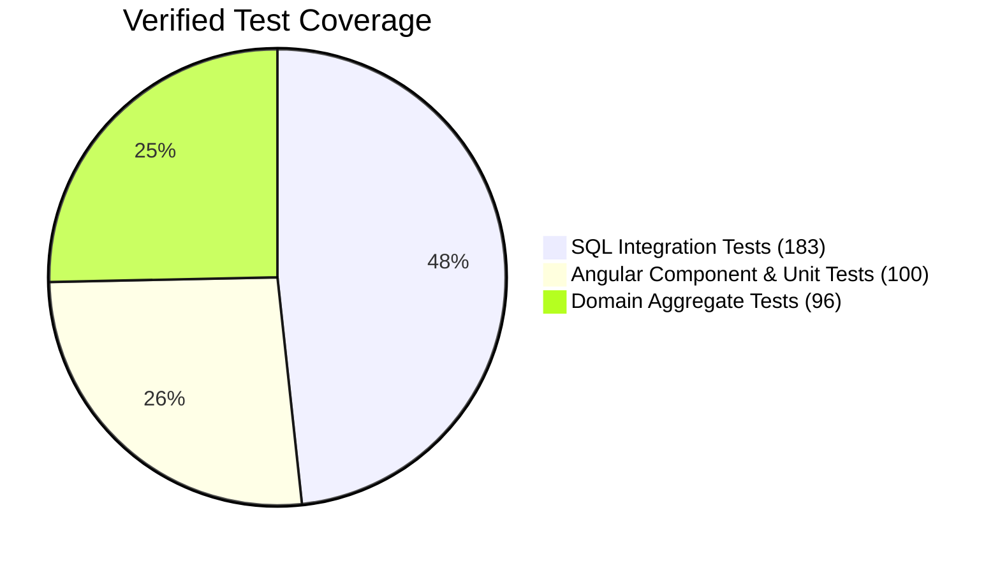

### Running Test Suites

#### 1. Domain Logic Tests (Unit)
Verifies core domain aggregates, scheduling rules, and state machine invariants without external dependencies:
```bash
dotnet test tests/Carpediem.Domain.Tests/Carpediem.Domain.Tests.csproj
```
*Result: 96 / 96 Passing*

#### 2. SQL Server Integration Tests
Executes full API integration flows against real SQL Server database tables with transactional rollbacks:
```bash
powershell -File tests/run-sql-integration.ps1
```
*Result: 183 / 183 Passing*

#### 3. Frontend Unit & Component Tests
Executes Angular tests via Vitest/Jasmine:
```bash
cd frontend
npx ng test --watch=false
```
*Result: 100 / 100 Passing*

#### 4. Frontend Production Build Check
Validates TypeScript compilation, template type-checking, and SCSS bundle budgets:
```bash
cd frontend
npx ng build
```
*Result: 0 errors, 0 budget warnings*

#### 5. End-to-End & Accessibility Audits
Runs full Playwright browser tests and automated Axe-core WCAG 2.2 AA accessibility evaluations:
```bash
cd tests/e2e
npx playwright test
```
*Result: 410 / 410 Passing across 5 device viewports (desktop, mobile-320, mobile-360, mobile-390, mobile-430), 0 accessibility violations, 0 horizontal layout overflows down to 320px*

---

## 10. Project Structure

```text
Carpediem/
├── .github/                   # CI/CD workflows and automation scripts
├── docs/                      # Technical documentation and media assets
│   ├── architecture/          # Architecture Decision Records (ADRs)
│   ├── demo/                  # Product demo video, thumbnail, storyboard & notes
│   │   ├── carpediem-product-demo.mp4
│   │   ├── demo-thumbnail.png
│   │   ├── demo-script.md
│   │   ├── production-notes.md
│   │   └── storyboard.md
│   ├── quality/               # UI audit and quality verification reports
│   │   ├── final-review.md
│   │   └── ui-audit.md
│   ├── roadmap/               # V1 status and implementation tracking
│   └── screenshots/           # Genuine unretouched application screenshots
│       ├── desktop/           # 1440x900 desktop screen captures
│       ├── mobile/            # 390x844 mobile screen captures
│       └── workflows/         # End-to-end interactive workflow captures
├── frontend/                  # Angular 22 Single-Page Application
│   ├── public/                # Static assets, self-hosted web fonts
│   ├── scripts/               # Video production and screenshot capture automation
│   └── src/                   # Feature components, services, and design system
│       ├── app/features/      # Domain feature components
│       └── app/layout/        # Header, navigation, and shell layout
├── src/                       # .NET 10 Modular Monolith Source Code
│   ├── Carpediem.Domain/      # Entities, aggregates, and domain business rules
│   ├── Carpediem.Infrastructure/ # EF Core DbContext, migrations, and SQL mappings
│   └── Carpediem.Web/         # Minimal endpoints, controllers, and auth pipeline
├── tests/                     # Automated Test Suites
│   ├── Carpediem.Api.IntegrationTests/ # ASP.NET Core + SQL Server integration tests
│   ├── Carpediem.Domain.Tests/        # Fast in-memory aggregate unit tests
│   └── e2e/                           # Playwright end-to-end testing suite
└── Carpediem.slnx             # Modern .NET solution file
```

---

## 11. Status and Roadmap

### Implemented Milestone: V1 Core Release (Slices 1–22)
- [x] Foundation & Account Registration with Administrator Activation
- [x] Draft Event Formulation & Role Staffing Requirements
- [x] Chief Leader Nomination, Notification, and Acceptance
- [x] Volunteer Shift Availability Scheduling & Declaration
- [x] Chief Leader Team Roster Selection & Locking
- [x] Post-Lock Replacement Workflows for No-Shows
- [x] Real-Time Attendance Roll Call & Verification
- [x] Emergency Event Cancellation & Schedule Modification
- [x] Volunteer Notification Inbox with Unread Counts
- [x] Volunteer Event Assignment & Reliability History
- [x] Post-Event Chief Leader Ratings & Feedback
- [x] Incident Reporting & Administrative Governance
- [x] Responsive Design System & WCAG 2.2 AA Accessibility Compliance

### Upcoming Milestone: V2 Platform Enhancements
- [ ] **Real-Time SignalR WebSockets**: Push instant live attendance and roster notifications directly to connected clients without polling.
- [ ] **Offline PWA Support**: Service worker caching and background sync for roll call checklists in venues with limited connectivity.
- [ ] **Certificate Generation**: Automated downloadable PDF certificates of completed volunteer service hours.
- [ ] **Multi-Tenant Support**: Granular organizational isolation for hosting independent volunteer branches.

---

## 12. Additional Documentation

For deeper technical dives, review the following repository references:
- **[UI Audit & Remediations](docs/quality/ui-audit.md)**: Comprehensive breakdown of identified UI/UX issues, root cause analyses, and verified solutions.
- **[Demo Production & Notes](docs/demo/production-notes.md)**: Technical specifications of the video encoding pipeline and reproduction guidelines.
- **[Screenshot Inventory](docs/screenshots/README.md)**: Full inventory of captured screens across desktop, mobile, and workflow states.
- **[V1 Implementation Status](docs/roadmap/V1_IMPLEMENTATION_STATUS.md)**: Granular task-by-task status across all 22 delivered functional slices.

---

*Carpediem — Engineered with precision for community leadership.*
