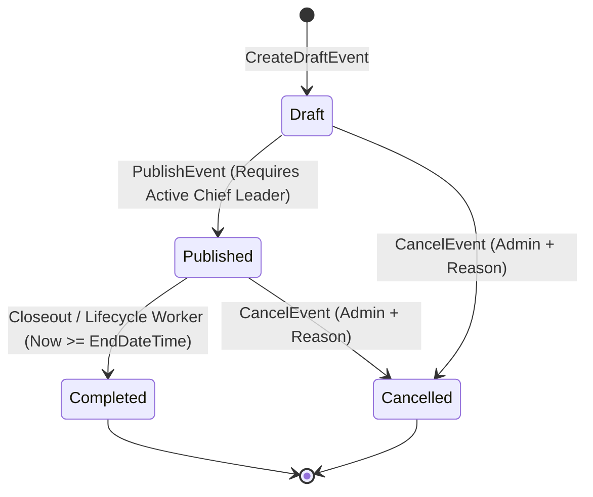
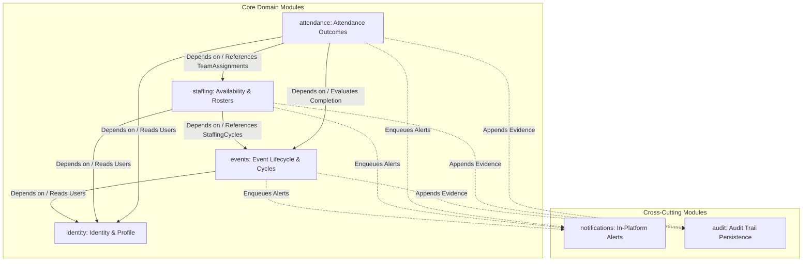

# Carpediem Architecture Consistency Review (Step 14)

> [!IMPORTANT]
> **Status**: ARCHITECTURAL BASELINE / COMPLETED  
> **Review Scope**: Cross-artifact coherence, domain invariant traceability, module boundaries, security model, relational schema, and concurrency integrity.  
> **Precedence**: Authoritative verification preceding the formal Architecture Lock.

---

## 1. Executive Summary & Review Scope

The Carpediem Architecture Consistency Review represents the exhaustive pre-lock audit of the engineering baseline. It verifies that every ratified business rule, state transition, authorization policy, and data persistence mechanism forms an airtight, internally consistent architectural foundation.

### 1.1 Reviewed Authoritative Baseline Artifacts
1. **Canonical Locked Requirements** (`3d6417d`):
   - [Product Discovery](file:///c:/dev/web/Carpediem/docs/product/PRODUCT_DISCOVERY.md)
   - [Conceptual Domain Model](file:///c:/dev/web/Carpediem/docs/requirements/CONCEPTUAL_DOMAIN_MODEL.md)
   - [Lifecycle Specification](file:///c:/dev/web/Carpediem/docs/requirements/LIFECYCLE_SPECIFICATION.md)
   - [Role & Permission Matrix](file:///c:/dev/web/Carpediem/docs/requirements/ROLE_PERMISSION_MATRIX.md)
2. **Ratified Requirements Amendment** (`1ecf437`):
   - [CHANGE-001: Chief Leader Dual-Role Participation](file:///c:/dev/web/Carpediem/docs/decisions/CHANGE-001-chief-leader-dual-role-participation.md)
3. **Architecture Context & Containers** (`093b229`):
   - [C1 System Context Diagram](file:///c:/dev/web/Carpediem/docs/architecture/c4/C1_SYSTEM_CONTEXT.md)
   - [C2 Container Architecture](file:///c:/dev/web/Carpediem/docs/architecture/c4/C2_CONTAINER.md)
   - [Modular Monolith Boundaries](file:///c:/dev/web/Carpediem/docs/architecture/MODULE_BOUNDARIES.md)
4. **Accepted Architecture Decision Records** (`b15a730`, `4512b81`):
   - [ADR-001: Architecture Pattern (Modular Monolith)](file:///c:/dev/web/Carpediem/docs/decisions/ADR-001-modular-monolith-architecture.md)
   - [ADR-002: Authentication & Session Strategy](file:///c:/dev/web/Carpediem/docs/decisions/ADR-002-authentication-session-strategy.md)
   - [ADR-003: Authorization & Resource Policies](file:///c:/dev/web/Carpediem/docs/decisions/ADR-003-authorization-resource-policies.md)
   - [ADR-004: Frontend Architecture (Angular SPA)](file:///c:/dev/web/Carpediem/docs/decisions/ADR-004-frontend-architecture.md)
   - [ADR-005: Audit Trail Strategy](file:///c:/dev/web/Carpediem/docs/decisions/ADR-005-audit-trail-strategy.md)
   - [ADR-006: In-Platform Notification Strategy](file:///c:/dev/web/Carpediem/docs/decisions/ADR-006-in-platform-notification-strategy.md)
   - [ADR-007: Background Processing Strategy](file:///c:/dev/web/Carpediem/docs/decisions/ADR-007-background-processing-strategy.md)
   - [ADR-008: Deployment & Containerization Strategy](file:///c:/dev/web/Carpediem/docs/decisions/ADR-008-deployment-containerization.md)
   - [ADR-009: SQL Server Persistence & Schema Organization](file:///c:/dev/web/Carpediem/docs/decisions/ADR-009-sql-server-persistence-and-schema-organization.md)
5. **Critical Domain & Architecture Sequence Specifications** (`91c87ab`):
   - [SEQ-001: Event Creation, Chief Leader Appointment & Publication](file:///c:/dev/web/Carpediem/docs/architecture/sequences/SEQ-001-event-creation-chief-leader-publication.md)
   - [SEQ-002: Volunteer Availability & Team Selection](file:///c:/dev/web/Carpediem/docs/architecture/sequences/SEQ-002-leader-availability-and-selection.md)
   - [SEQ-003: Direct Leader Assignment](file:///c:/dev/web/Carpediem/docs/architecture/sequences/SEQ-003-direct-leader-assignment.md)
   - [SEQ-004: Self-Cancellation & Replacement](file:///c:/dev/web/Carpediem/docs/architecture/sequences/SEQ-004-cancellation-and-replacement.md)
   - [SEQ-005: Dual-Role Chief Leader Participating as Leader](file:///c:/dev/web/Carpediem/docs/architecture/sequences/SEQ-005-dual-role-chief-leader-as-leader.md)
   - [SEQ-006: Pending Chief Leader Candidate Conflict Resolution](file:///c:/dev/web/Carpediem/docs/architecture/sequences/SEQ-006-pending-chief-leader-conflict-resolution.md)
   - [SEQ-007: Event Reschedule & StaffingCycle Invalidation](file:///c:/dev/web/Carpediem/docs/architecture/sequences/SEQ-007-event-reschedule-staffing-cycle.md)
   - [SEQ-008: Attendance Finalization & Correction](file:///c:/dev/web/Carpediem/docs/architecture/sequences/SEQ-008-attendance-finalization-and-correction.md)
6. **Logical Data Model, Schema & ERD Specifications** (`e66ce52`):
   - [Logical Data Model](file:///c:/dev/web/Carpediem/docs/data/LOGICAL_DATA_MODEL.md)
   - [Relational Schema Specification](file:///c:/dev/web/Carpediem/docs/data/RELATIONAL_SCHEMA.md)
   - [Core ERD Diagrams](file:///c:/dev/web/Carpediem/docs/architecture/erd/ERD_CORE.md)
   - [Constraint Catalog](file:///c:/dev/web/Carpediem/docs/data/CONSTRAINT_CATALOG.md)
   - [Index Candidates & Query Strategy](file:///c:/dev/web/Carpediem/docs/data/INDEX_CANDIDATES.md)
7. **SQL Server Concurrency & Integrity Specifications** (`011b110`):
   - [Transaction Boundaries & Atomicity](file:///c:/dev/web/Carpediem/docs/data/TRANSACTION_BOUNDARIES.md)
   - [Concurrency Model & Race Analysis](file:///c:/dev/web/Carpediem/docs/data/CONCURRENCY_MODEL.md)
   - [SQL Server Data Integrity Review](file:///c:/dev/web/Carpediem/docs/data/SQL_SERVER_INTEGRITY_REVIEW.md)

---

## 2. Review Dimension A: Business Rule Traceability

Every invariant defined in the canonical and ratified requirements has an identified, verified architectural enforcement location:

| Lifecycle Invariant / Rule | Domain Aggregate Guard | Authorization Enforcement | Persistence Constraint | Concurrency / Coordination Guard | Mandatory Audit Required |
| :--- | :--- | :--- | :--- | :--- | :--- |
| **Event Creation in `Draft`** | `Event.Create()` enforces initial state | `RequireRole("Admin")` (ADR-003) | `CK_Events_Status`, default `'Draft'` | None (New entity) | `Events.EventCreated` (Optional/Audited) |
| **Appoint Chief Leader** | Event must be `Draft`; candidate has `ChiefLeader` role | `RequireRole("Admin")` | FK to `identity.Users`, `CK_ChiefLeaderAssignments_Status` | Filtered unique index `UX_ChiefLeaderAssignments_ActivePerEvent` | NO |
| **Chief Leader Direct Acceptance** | Assignment must be `Pending`; user is assigned candidate | Resource Policy (Candidate ownership) | `CK_ChiefLeaderAssignments_Status` | `ChiefLeaderAssignments.RowVersion` + Race 2 Event coordination lock | NO |
| **Chief Leader External Acceptance** | Assignment must be `Pending`; mandatory reason provided | `RequireRole("Admin")` | `CK_ChiefLeaderAssignments_Status` | `ChiefLeaderAssignments.RowVersion` + Race 2 Event coordination lock | **YES** (`ChiefLeader.ExternalAcceptanceRecorded`) |
| **Event Publication** | Event in `Draft`; exactly one `Active` Chief Leader | `RequireRole("Admin")` | `CK_Events_Status`, `PublishedAt NOT NULL` | `Events.RowVersion` (Guarded transition) | `Events.EventPublished` |
| **Availability Submission** | Target event is `Published`; cycle is current | `RequireRole("Leader")` | FK to `events.StaffingCycles(Id)` | Cycle currency check (`IsCurrent == 1`) in transaction | NO |
| **Team Candidate Selection** | Target event is `Published`; cycle is current; user not assigned | Resource Policy (Active Chief Leader or Admin) | FKs to `StaffingCycles`, `Users` | Filtered index `UX_TeamAssignments_ActiveLeaderPerCycle` + Race 2 Event lock | NO |
| **Direct Leader Assignment** | Target event is `Published`; cycle is current; candidate has `Leader` role | Resource Policy (Active Chief Leader or Admin) | FKs to `StaffingCycles`, `Users` | Filtered index `UX_TeamAssignments_ActiveLeaderPerCycle` + Race 2 Event lock | NO |
| **Volunteer Self-Cancellation** | Assignment is `Active`; mandatory reason provided | Resource Policy (Assignment ownership) | `CK_TeamAssignments_Status` | `TeamAssignments.RowVersion` (Race 6) | **YES** (`Staffing.LeaderSelfCancelled`) |
| **Admin Staffing Override** | Assignment is `Active`; mandatory reason provided | `RequireRole("Admin")` | `CK_TeamAssignments_Status` | `TeamAssignments.RowVersion` (Race 6) | **YES** (`Staffing.AdminOverride`) |
| **Event Date Reschedule** | Event is `Published`; invalidates current cycle; creates new cycle | `RequireRole("Admin")` | Filtered index `UX_StaffingCycles_CurrentPerEvent` | `Events.RowVersion` + Event coordination lock (Races 4, 5) | `Events.EventRescheduled` (Audited) |
| **Event Cancellation** | Event is `Draft` or `Published`; mandatory reason provided | `RequireRole("Admin")` | `CK_Events_Status`, `CancelledAt NOT NULL` | `Events.RowVersion` | **YES** (`Events.EventCancelled`) |
| **Event Completion** | Event is `Published`; `EndDateTime` has passed | `RequireRole("Admin")` or Background Worker | `CK_Events_Status` | Guarded transition `WHERE Status = 'Published'` + `RowVersion` (Races 9, 10) | `Events.EventCompleted` |
| **Attendance Finalization** | Event is `Completed`; assignment was `Active` on current cycle | Resource Policy (Active Chief Leader or Admin) | Unique `UX_AttendanceOutcomes_Assignment` on `TeamAssignmentId` | First-write unique constraint (Race 8) | NO |
| **Attendance Correction** | Prior outcome exists; mandatory reason provided | `RequireRole("Admin")` | `CK_AttendanceOutcomes_Outcome` | `AttendanceOutcomes.RowVersion` (Race 8) | **YES** (`Attendance.OutcomeCorrected`) |

> [!NOTE]
> **Orphan Invariant Check**: Zero orphan business rules exist. Every business rule in canonical documentation maps to verified architectural controls.

---

## 3. Review Dimension B: State Model Consistency

All entity lifecycle state machines and absence semantics across all documents are strictly aligned:

### 3.1 Formal Entity State Specifications
1. **`events.Events`**:
   - Persisted States: `Draft`, `Published`, `Completed`, `Cancelled`
   - Check Constraint: `CK_Events_Status`
   - Terminal States: `Completed`, `Cancelled`
2. **`events.ChiefLeaderAssignments`**:
   - Persisted States: `Pending`, `Active`, `Declined`
   - Check Constraint: `CK_ChiefLeaderAssignments_Status`
   - Invariant: At most one row with `Status = 'Active'` per `EventId` (`UX_ChiefLeaderAssignments_ActivePerEvent`).
3. **`staffing.AvailabilityResponses`**:
   - Persisted States: `Available`, `NotAvailable`
   - Check Constraint: `CK_AvailabilityResponses_Status`
   - **Absence Semantics**: Absence of a row for a given volunteer and cycle represents **"No Response Submitted" ("Response Needed")**. Zero placeholder rows are stored.
4. **`staffing.TeamAssignments`**:
   - Persisted States: `Active`, `Cancelled`
   - Check Constraint: `CK_TeamAssignments_Status`
   - **Absence Semantics**: Absence of a row represents **"Not Assigned"**. Zero placeholder rows.
   - Single Active Invariant: Filtered unique index `UX_TeamAssignments_ActiveLeaderPerCycle` guarantees at most one active assignment per volunteer per cycle.
5. **`attendance.AttendanceOutcomes`**:
   - Persisted States: `Attended`, `NoShow`
   - Check Constraint: `CK_AttendanceOutcomes_Outcome`
   - **Absence Semantics**: Absence of an outcome row for an active assignment represents **"Unrecorded"**.
   - Derived Read Model: **"Pending Attendance"** is a runtime projection over completed events with active operational assignments lacking an `AttendanceOutcomes` row. Zero persisted `Unrecorded` or `Pending` rows exist.

---

## 4. Review Dimension C: CHANGE-001 Dual-Role Trace

CHANGE-001 establishes that users may hold both `ChiefLeader` and `Leader` capabilities across the platform, while remaining subject to strict mutual exclusivity on any individual event:

$$\text{ActiveChiefLeaderAssignment}(E, U) \iff \neg\text{CurrentOperationalTeamAssignment}(E, U)$$

### 4.1 Traceability Across the Architectural Stack
1. **Identity & Claims**:
   - Users are assigned discrete roles (`ChiefLeader`, `Leader`, `Admin`) in `identity.UserRoles`.
   - **No Role Inheritance**: A `ChiefLeader` role does not inherit or grant `Leader` permissions.
   - **No Qualification Flags**: Fields such as `IsChiefLeaderQualified` are explicitly rejected. Capabilities stem solely from assigned roles.
2. **Authorization Layer (ADR-003)**:
   - Command handlers evaluate specific role claims: `RequireRole("ChiefLeader")` for leadership appointments; `RequireRole("Leader")` for availability and team assignments.
   - Cross-role resource policies check current event assignments to ensure a user is never operational in both capacities simultaneously.
3. **Sequence Workflows (SEQ-005, SEQ-006)**:
   - Sequence specifications demonstrate that a dual-role user can serve as Chief Leader on Event 1 while serving as a regular Leader on Event 2.
   - Contending workflows serialize on the parent Event coordination lock.
4. **Relational Data Model & Operational Context**:
   - The operational context rule is strictly enforced:
     $$\text{CurrentOperationalTeamAssignment}(E, U) \iff \text{TeamAssignment.Status} = \text{'Active'} \;\land\; \text{StaffingCycle.IsCurrent} = 1$$
   - Historical active assignments on archived cycles (`IsCurrent = 0`) do not prevent a dual-role user from accepting a Chief Leader appointment on the rescheduled event date.
5. **Concurrency & Race Serialization (Race 2)**:
   - Enforced across all five activating command paths: `AcceptChiefLeaderDirect`, `RecordExternalAcceptance`, `SelectCandidate`, `DirectDraft`, and `DraftReplacement`.
   - All paths acquire an update lock on the parent `events.Events` row inside the transaction and revalidate the mutual exclusivity invariant before committing.

---

## 5. Review Dimension D: History & Non-Destructive Lifecycle Trace

Carpediem's domain requires an immutable operational history for auditability, volunteer reliability metrics, and post-event analysis:

1. **Staffing Cycle Archiving**:
   - Rescheduling an event never mutates or cascades onto existing assignments or availability responses.
   - Setting `StaffingCycles.IsCurrent = 0` preserves all prior records as an immutable snapshot.
2. **Cancelled Assignments**:
   - Volunteer self-cancellation and administrative overrides update `TeamAssignment.Status = 'Cancelled'` and record mandatory audit entries. Rows are never deleted.
3. **Declined Leadership Appointments**:
   - When a candidate declines a Chief Leader appointment, `ChiefLeaderAssignments.Status` updates to `'Declined'`. The record remains permanently in place to preserve coordinator appointment history.
4. **Attendance Corrections**:
   - Correcting an attendance outcome updates the existing row via optimistic concurrency (`RowVersion`) and appends an immutable `audit.AuditLogs` record capturing the prior outcome, new outcome, modifying administrator, and mandatory reason.
5. **Foreign Key Integrity**:
   - All relational foreign keys linking historical records (`ChiefLeaderAssignments`, `StaffingCycles`, `TeamAssignments`, `AvailabilityResponses`, `AttendanceOutcomes`) configure `ON DELETE NO ACTION`. Cascading deletes are strictly prohibited across the operational schema.
6. **Data Retention**:
   - Long-term archival and purge schedules remain explicitly unresolved and deferred to post-lock data governance specifications.

---

## 6. Review Dimension E: Module Boundaries & Dependency DAG

Carpediem follows a Modular Monolith architecture (ADR-001) where logical modules define strict boundaries within a single deployable host:

> [!NOTE]
> **Dependency Notation**: In the diagram and text below, the arrow notation `A --> B` denotes **"Module A depends on Module B"** (A consumes contracts/types provided by B).

### 6.1 Dependency Validation
- **Logical Dependency DAG**: The module dependency structure is strictly acyclic:
  - `Events` depends on: `Identity` (resolves user existence and role claims for appointments).
  - `Staffing` depends on: `Events` (references `events.StaffingCycles(Id)`) and `Identity` (resolves volunteer identity for availability and roster assignments).
  - `Attendance` depends on: `Staffing` (references `staffing.TeamAssignments(Id)`), `Events` (evaluates event completion context), and `Identity` (resolves user identity for roll-call/corrections).
- **Cross-Cutting Modules**:
  - **Audit**: Append-oriented cross-cutting persistence. Domain commands record mandatory audit entries within the host transaction; normal business workflows do not mutate or delete historical audit evidence.
  - **Notifications**: Owned by the `Notifications` module. Notification records are persisted within the database transaction, while client presentation/polling is decoupled. Because notification read state is mutable through `ReadAt`, **Notifications are NOT append-only**.
- **Zero Circular Write Dependencies**:
  - `Events` owns `events.Events`, `events.StaffingCycles`, and `events.ChiefLeaderAssignments`.
  - `Staffing` owns `staffing.TeamAssignments` and `staffing.AvailabilityResponses`. It maintains a foreign key to `events.StaffingCycles(Id)` but never writes to the `events` schema.
  - `Attendance` owns `attendance.AttendanceOutcomes`. It references `staffing.TeamAssignments(Id)` but never mutates staffing tables.
  - Each module strictly controls write mutations to its owned schema tables.

---

## 7. Review Dimension F: Security & Authorization Consistency

The security architecture across ADR-002, ADR-003, and ADR-008 forms a coherent, defense-in-depth model:

1. **Same-Origin Authentication (ADR-002 & ADR-008)**:
   - ASP.NET Core Identity authentication cookies are configured with `HttpOnly`, `SameSite=Lax` (or `Strict`), and `Secure`.
   - CloudFront reverse-proxies `/api/*` and `/hub/*` to the application container on the exact same domain that serves the Angular SPA. This preserves first-party same-origin semantics and eliminates Safari ITP third-party cookie restrictions.
   - Bearer tokens are strictly excluded from browser `localStorage` and `sessionStorage`, materially reducing token-exfiltration vulnerabilities.
2. **CSRF Defense**:
   - Antiforgery tokens are generated by ASP.NET Core and validated on all unsafe HTTP methods (`POST`, `PUT`, `DELETE`, `PATCH`).
3. **Server-Side Authorization Authority (ADR-003)**:
   - The server is the sole source of truth for authorization. Angular route guards and UI button states are UX affordances only.
   - Commands enforce server-side role policies (`RequireRole("Admin")`, `RequireRole("ChiefLeader")`, `RequireRole("Leader")`) and imperative resource-based handlers (`IAuthorizationHandler`) that re-verify entity ownership and operational status before executing mutations.
4. **Privileged Audit & Data Integrity (ADR-005)**:
   - The `audit.AuditLogs` table provides append-oriented, transactionally consistent audit evidence with restricted privileged access and deployment-hardening controls. Normal business workflows do not mutate or delete historical audit evidence.
   - Audit logs are accessible exclusively to authenticated Administrators through dedicated query endpoints.

---

## 8. Review Dimension G: Relational Data, Concurrency & Engine Integrity

The database architecture leverages Microsoft SQL Server 2025 features while maintaining rigorous isolation boundaries:

1. **Isolation Baseline**:
   - `READ_COMMITTED_SNAPSHOT ON` (RCSI) materially reduces reader-writer deadlocks and blocking by serving row-versioned snapshots from `tempdb`.
   - Writers acquire standard exclusive (`X`/`IX`) locks, preventing dirty writes and concurrent overlapping mutations.
2. **Deterministic Coordination & Cross-Table Integrity**:
   - Targeted update locks (`UPDLOCK`) on the parent `events.Events` coordination row serialize contending workflows (CHANGE-001 exclusivity, reschedule races) within the host transaction.
   - Invariants are revalidated immediately upon acquiring coordination.
3. **Storage-Engine Declarative Invariants**:
   - Filtered unique indexes enforce single-active constraints at the engine level:
     - `UX_StaffingCycles_CurrentPerEvent`: At most one current staffing cycle per event.
     - `UX_ChiefLeaderAssignments_ActivePerEvent`: At most one active Chief Leader per event.
     - `UX_TeamAssignments_ActiveLeaderPerCycle`: At most one active assignment per volunteer per cycle.
   - Unique constraint `UX_AttendanceOutcomes_Assignment`: At most one attendance record per assignment.
4. **Optimistic Concurrency Coverage**:
   - `RowVersion rowversion NOT NULL` on selected concurrency-sensitive operational entities: `events.Events`, `events.ChiefLeaderAssignments`, `staffing.TeamAssignments`, and `attendance.AttendanceOutcomes`. Other tables rely on declarative unique indexes, status preconditions, or natural idempotency.
5. **Honest Concurrency Commitments**:
   - No absolute claims that "deadlocks are impossible" or that "readers never block writers under any circumstance".
   - Bounded deadlock retry policy restarts transactions cleanly from the beginning, re-evaluating fresh row versions and invariants.

---

## 9. Review Dimension H: Deferred Product Decisions

The architecture baseline rigorously avoids making unratified product decisions. The following items are explicitly recorded as **DEFERRED TO FEATURE SPECIFICATIONS**:

1. **Complete Event Field Set**: Custom fields, equipment lists, meeting links, tags, and categorical classifications.
2. **LeaderProfile Extended Attributes**: Skills taxonomy, shirt size, emergency contacts, biography, and profile imagery.
3. **Feedback & Review Rubric**: Post-event review questions, numerical rating scales, and role-based feedback visibility rules.
4. **Incident Reporting Specifications**: Incident categorization, severity levels, and automated emergency notification trees.
5. **Post-Publication Chief Leader Lifecycle**: Operational workflows for post-publication active Chief Leader withdrawal, emergency reassignment, or delegation.
6. **Volunteer Reliability & Commitment Formulas**: Mathematical algorithms for calculating leader reliability scores, commitment ratios, or volunteer tiers.
7. **Cancellation Penalty Policies**: Automated cooldown periods, strike systems, and late-cancellation penalty enforcement rules.
8. **Data Retention & Archival Policies**: Retention, privacy, archival, and deletion/anonymization requirements (remain deferred product/legal decisions).
9. **Leader Onboarding & Invitation Workflows**: Registration invitation links, self-onboarding flows, and administrative vetting pipelines.
10. **Notification Delivery & Trigger Rules**: Notification reminder timing, broadcast criteria, and any future external delivery channels (SMS, push, and external messaging channels remain outside approved V1).
11. **Roster Capacity & Quotas**: Exact maximum roster limits, slot reservations, and replacement slot allocation rules.

---

## 10. Review Dimension I: Implementation Readiness & Architecture Decision

### 10.1 Blockers & Contradictions Assessment
- **Architecture Contradictions**: **ZERO**.
- **Cross-Artifact Divergence**: **ZERO**.
- **Architecture-Level Blockers**: **ZERO**.

### 10.2 Post-Lock Governance Sequence
Locking the architecture does **NOT** authorize jumping directly to implementation coding or prematurely selecting features. The established governance sequence following Architecture Lock is:

1. **Epic / Feature Slicing**: Deconstruct requirements into cohesive vertical slices.
2. **Prioritize V1 Feature Slices**: Rank slices by dependency and core business value.
3. **Choose First Vertical Feature**: Select the initial slice based on prioritization.
4. **Spec Kit `/specify`**: Author the feature specification (`spec.md`).
5. **Spec Kit `/clarify`**: Resolve underspecified requirements and edge cases.
6. **Define Acceptance Criteria / Stories**: Break specification into verifiable stories.
7. **Lock Feature / Story**: Formal sign-off on the feature specification.
8. **Spec Kit `/plan`**: Create the technical implementation plan.
9. **Spec Kit `/tasks`**: Generate actionable, dependency-ordered tasks.
10. **Implementation**: Only then dispatch verified tasks for implementation execution.

### 10.3 Final Verdict & Meaning of Lock
$$\mathbf{ARCHITECTURE\; STATUS:\; LOCKED\; FOR\; FEATURE\; SPECIFICATION\; \&\; IMPLEMENTATION\; PLANNING}$$

This certification means:
- The architecture baseline is **consumable by feature specifications**.
- Unresolved feature and business rules **remain unresolved** until addressed in feature specs.
- Any future architecture modification requires **explicit ADR / change governance**.
- Any business rule modification requires **formal requirements governance**.
- Implementation workflows **MUST NOT invent missing feature requirements**.
