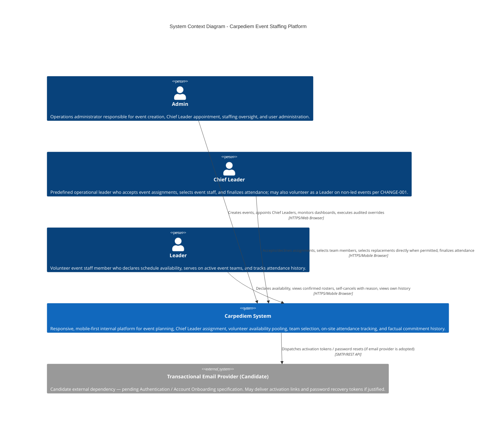

# C4 Level 1: System Context — Carpediem

> [!IMPORTANT]
> **Status: PROPOSED ARCHITECTURAL BASELINE**
> **Scope**: High-level structural boundary, user roles, and external interactions for the Carpediem platform.
> **Governing Standards**: C4 Model Level 1 (System Context), locked Carpediem canonical source of truth, and locked lifecycle specification.

---

## 1. System Context Diagram

---

## 2. System Description & Purpose

**Carpediem** is a purpose-built, internal web application designed to replace fragmented, chaotic event coordination previously conducted across WhatsApp groups, ad-hoc spreadsheets, and manual phone trees.

- **Primary Goal**: Centralize event publishing, candidate pooling, team selection, and attendance tracking into a single, mobile-first operational hub.
- **Scale Profile [LOCKED]**:
  - ~100–150 active Leaders
  - ~10–15 predefined Chief Leaders
  - ~3 Operations Admins
  - ~2–20 events per month
- **UX Paradigm [LOCKED]**: **Mobile-First Responsive Web**. Volunteer Leaders and Chief Leaders interact with the system predominantly from mobile smartphones on-the-go or on-site at event venues.

---

## 3. Human Actors & User Personas

| Actor | Persona Profile | Key Capabilities in Carpediem | Operational Context | Status |
| :--- | :--- | :--- | :--- | :--- |
| **Admin** | Core Operations & Management (~3 users) | - Author and schedule events (`Draft` $\rightarrow$ `Published`) - Appoint Chief Leaders from predefined pool - Record externally confirmed Chief Leader acceptance with mandatory audit note - Audited team selection and attendance overrides - User account provisioning and access control | Desktop browser, office/operations environment | **LOCKED** |
| **Chief Leader** | Predefined Operational Field Leaders (~10–15 users) | - Review event assignments (`Pending` $\rightarrow$ `Active` / `Declined`) - Operational ownership of accepted events - Review available candidate pool and select team members - Directly draft unassigned Leaders when necessary - Select replacements directly when permitted upon Leader cancellation - Conduct roll call and directly finalize attendance (`Attended` / `NoShow`) - May also hold `Leader` role per [CHANGE-001](file:///c:/dev/web/Carpediem/docs/decisions/CHANGE-001-chief-leader-dual-role-participation.md) and participate as volunteer staff on non-led events (same-event exclusivity strictly enforced) | Mobile-first browser, on-site at venues, field coordination | **LOCKED (Updated per CHANGE-001)** |
| **Leader** | Volunteer Event Personnel (~100–150 users) | - Maintain approved profile details - Submit schedule availability per event staffing cycle (`Available` $\leftrightarrow$ `NotAvailable`) - Immediate confirmation upon leadership selection - Controlled self-cancellation with mandatory reason - View factual event participation history | Mobile browser on personal smartphones | **LOCKED** |

---

## 4. System Boundary & Core Responsibilities

The **Carpediem System** encompasses all application workflows required to coordinate an event from initial draft scheduling through to post-event closeout:

### Core Responsibilities Within Carpediem Boundary
1. **Event Scheduling & Lifecycle Management [LOCKED]**: Managing event drafts, scheduled windows, locations, and state transitions (`Draft`, `Published`, `Completed`, `Cancelled`).
2. **Chief Leader Assignment Workflow [LOCKED]**: Enforcing explicit appointment, notification, acceptance/decline states, and external confirmation audit trails.
3. **Availability Collection [LOCKED]**: Collecting and updating volunteer availability per event `StaffingCycle`.
4. **Team Selection & Replacement [LOCKED]**: Enabling Chief Leaders to staff teams directly, select replacements directly when permitted, and record self-cancellations with immutable history.
5. **On-Site Attendance Finalization [LOCKED]**: Recording physical presence and no-shows directly post-event, with audited Admin correction capabilities.
6. **Factual Reliability History [LOCKED]**: Tracking raw historical indicators (attended count, cancelled count, no-show count) without synthetic formulas or black-box rating algorithms.
7. **In-Platform Notifications [LOCKED]**: Real-time operational alerts for assignments, schedule updates, cancellations, and staffing gaps.

---

## 5. External Systems & Integration Boundary

In strict alignment with the locked project scope, external integrations are rigorously constrained:

### Candidate External Dependencies [PROPOSED / UNRESOLVED]
- **Transactional Email Provider (Candidate — Pending Account Onboarding Specification)**:
  - *Status*: **PROPOSED / PENDING SPECIFICATION**.
  - *Context*: Account onboarding and invitation mechanisms remain unresolved (Section 13 Decision 9). If automated email invitations or password recovery tokens are formally justified, an outbound SMTP or REST provider (e.g., AWS SES / SMTP) will be integrated.
  - *Constraint*: Candidate external dependency pending Authentication / Account Onboarding specification. Failure semantics will be defined by that feature and ADR.

### Systems Not Integrated in V1 Scope
- **WhatsApp API / Chatbots [LOCKED OUT-OF-SCOPE]**: Strictly prohibited in V1. WhatsApp coordination chaos is solved by moving workflows into Carpediem's mobile web portal, not by building chat integrations.
- **SMS Gateways [LOCKED OUT-OF-SCOPE]**: No SMS alerts in V1. All notifications are delivered via the in-platform notification system.
- **Mobile OS Push Notification Services (APNs / FCM) [LOCKED OUT-OF-SCOPE]**: No native app push or browser web push in V1.
- **External HR / Enterprise Directory Systems (Active Directory / LDAP / Workday)**: Not currently part of the approved V1 architecture / no integration planned. Carpediem manages its own internal identity, credentials, and role assignments.
- **External File Storage / CDN (S3 / Azure Blob)**: Minimal file asset requirements in V1 (profile avatars or simple attachments); handled locally or deferred until AWS phase.
- **Analytics & BI Warehouses**: Factual operational dashboards are rendered directly from relational operational read models within Carpediem.
