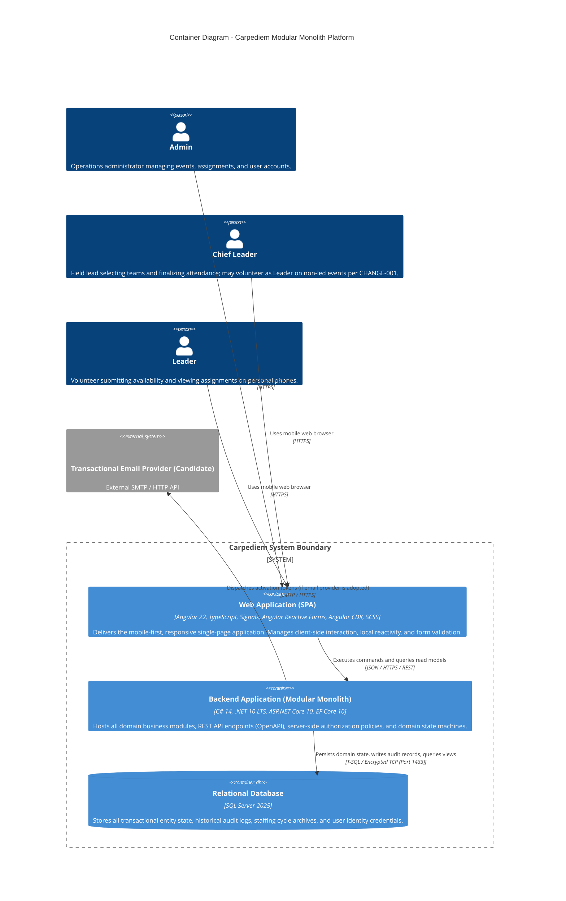

# C4 Level 2: Container Architecture — Carpediem

> [!IMPORTANT]
> **Status: PROPOSED ARCHITECTURAL BASELINE**
> **Scope**: High-level execution environments, containers, protocols, and data boundaries for the Carpediem platform.
> **Governing Architecture**: **Modular Monolith** over ASP.NET Core 10 and Angular 22. No microservices or distributed message brokers.

---

## 1. Container Diagram

---

## 2. Container Specifications

### A. Web Application (Single-Page Application)
- **Primary Responsibility [LOCKED]**:
  - Delivers a high-performance, responsive, mobile-first user interface for all three personas.
  - Implements client-side routing, responsive layouts (optimized for mobile touch screens and venue roll calls), dynamic status rendering (e.g., "Response Needed", "Pending Attendance"), and accessible form validation.
  - Manages reactive state using Angular Signals and RxJS streams.
- **Technology Stack [LOCKED]**:
  - **Framework**: Angular 22.
  - **Language**: TypeScript (exact compatible version managed by the Angular 22 workspace toolchain; not independently locked at architecture level).
  - **Reactivity & State**: Angular Signals (`signal`, `computed`, `linkedSignal`) for UI state; RxJS for asynchronous HTTP events.
  - **Forms**: Angular Reactive Forms with strict typing.
  - **Components & Layout**: Angular CDK (a11y, overlay, clipboard) + custom SCSS adhering to mobile-first responsive design tokens.
- **Communication Protocol [LOCKED]**:
  - Outbound to Backend API via `HTTPS` / `JSON` using Angular `HttpClient` / `httpResource`.
  - Secure session/token authentication (strategy evaluated in ADR-002).
- **Trust Boundary [LOCKED]**:
  - **Untrusted Client Environment**: Runs entirely within the user's mobile or desktop browser.
  - **Zero Domain Authority**: The client NEVER enforces business invariants, state transitions, or role authorizations authoritatively; all operations are strictly validated and authorized server-side.
- **Data Ownership [LOCKED]**:
  - Ephemeral client-side view state only (cached responses, form drafts, UI filters).
  - No local permanent persistence (no IndexedDB required for V1 core flows).
- **Deployment Responsibility [PROPOSED]**:
  - Angular SPA is an independently built static frontend artifact, targeted for Amazon S3 + CloudFront CDN in production (or served via local reverse proxy in development). It is **not** bundled into a single runtime container with the backend API.

---

### B. Backend Application (Modular Monolith)
- **Primary Responsibility [LOCKED]**:
  - Acts as the single backend host encompassing all domain business modules: Identity, Events (including Chief Leader Assignment and StaffingCycle), Staffing (AvailabilityResponse + TeamAssignment), Attendance (AttendanceOutcome), LeaderProfiles, Feedback, Incidents, and Notifications.
  - Enforces all formal state machine transitions and domain invariants defined in [`docs/requirements/LIFECYCLE_SPECIFICATION.md`](file:///c:/dev/web/Carpediem/docs/requirements/LIFECYCLE_SPECIFICATION.md).
  - Exposes typed REST API contracts documented via OpenAPI (Swagger).
  - Authors immutable audit records for all critical operational mutations.
- **Technology Stack [LOCKED]**:
  - **Runtime & Language**: C# 14 on .NET 10 LTS.
  - **Framework**: ASP.NET Core 10 (Minimal APIs or feature-based Controllers with OpenAPI).
  - **Data Access**: Entity Framework Core 10 (EF Core 10).
  - **Observability**: Built-in .NET `ILogger` structured logging, Serilog with JSON formatting, and OpenTelemetry-ready metrics.
- **Communication Protocol [LOCKED]**:
  - Inbound: `HTTPS` (TLS 1.3) accepting REST JSON payloads from the Angular SPA.
  - Outbound: Encrypted TCP connection to SQL Server 2025; outbound HTTPS/SMTP to Transactional Email provider (if adopted).
- **Trust Boundary [LOCKED]**:
  - **High Trust Application Boundary**: Resides within the secured private application network.
  - Enforces server-side authentication, role-based authorization policies, resource-based handlers for Chief Leader event ownership, input validation, and transactional atomicity.
- **Data Ownership [LOCKED]**:
  - Master domain logic and transaction boundaries.
  - Generates SQL queries, manages connection pooling, and coordinates database migrations.
- **Deployment Responsibility [PROPOSED]**:
  - Independent containerized executable (`Dockerfile` based on official `mcr.microsoft.com/dotnet/aspnet:10.0` Linux image).
  - Targeted for AWS ECS/Fargate behind an Application Load Balancer (ALB) in production, and Docker Compose for local development (details finalized in ADR-008).

---

### C. Relational Database (SQL Server 2025)
- **Primary Responsibility [LOCKED]**:
  - Authoritative persistence store for all transactional domain aggregates, immutable audit logs, user credentials, and historical staffing cycle revisions.
  - Enforces relational referential integrity (foreign keys, check constraints, unique indexes).
  - Guarantees ACID compliance across state transitions (e.g., rotating a `StaffingCycle` within a single atomic transaction).
- **Technology Stack [LOCKED]**:
  - **Database Engine**: Microsoft SQL Server 2025 (Standard / Developer Edition in local containers; Amazon RDS for SQL Server or SQL Server on Linux container in production).
- **Schema & Organization [PROPOSED / PENDING ADR-009]**:
  - Schema-per-module isolation (e.g., `events`, `staffing`, `identity`, `attendance`) is **proposed** to prevent table-level entanglements, but physical schema organization and migration strategy remain subject to ADR-009.
- **Communication Protocol [LOCKED]**:
  - Inbound: Encrypted TDS protocol over TCP (Default port 1433) restricted exclusively to the Backend API container.
- **Trust Boundary [LOCKED]**:
  - **Maximum Trust Data Tier**: Isolated in a private network segment / database subnet.
  - Direct external access from the public internet or user browsers is strictly blocked by network security rules.
- **Data Ownership [LOCKED]**:
  - Sole physical owner of all persistent Carpediem operational data and historical archives.
- **Deployment Responsibility [PROPOSED]**:
  - Local: Managed via `docker-compose` utilizing the official SQL Server 2025 container image with persistent volume mounts.
  - Production: Managed RDS SQL Server instance or dedicated container with automated daily snapshots and point-in-time recovery (PITR).

---

## 3. Internal Supporting Runtime Components

To maintain architectural simplicity without introducing external distributed middleware:

1. **Background Processing Capability [PROPOSED / PENDING ADR-007]**:
   - Background execution capability may use ASP.NET Core `BackgroundService` when a justified requirement exists (ADR-007 pending).
   - No scheduled lifecycle sweepers are assumed at this baseline. The architecture functions correctly whether temporal conditions (such as `In Progress` or `Pending Attendance`) are evaluated dynamically at runtime upon query/request or updated via a hosted background worker.
2. **In-Platform Notification Delivery [PROPOSED / PENDING ADR-006]**:
   - In-platform notifications are stored relationally alongside triggering business transactions.
   - Client retrieval mechanism (REST polling vs. lightweight SignalR WebSocket hub) will be determined in ADR-006.
3. **Audit Trail Persistence Strategy [PROPOSED / PENDING ADR-005]**:
   - Captures mandatory justification notes, actor identities, timestamps, and state changes for auditable operations.
   - The concrete implementation pattern (explicit domain events vs. persistence interception vs. hybrid) will be resolved in ADR-005.
