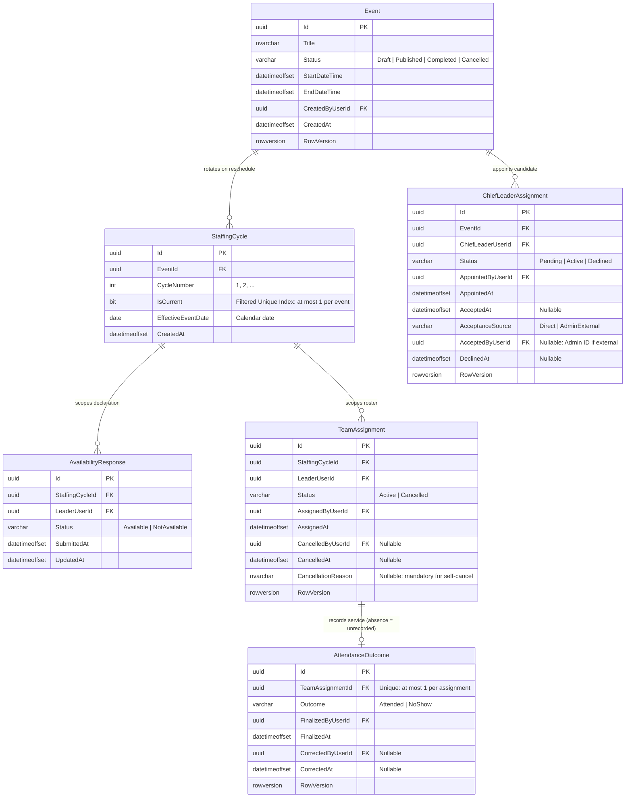
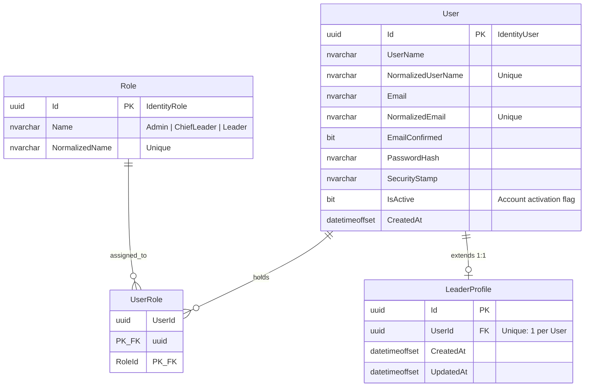
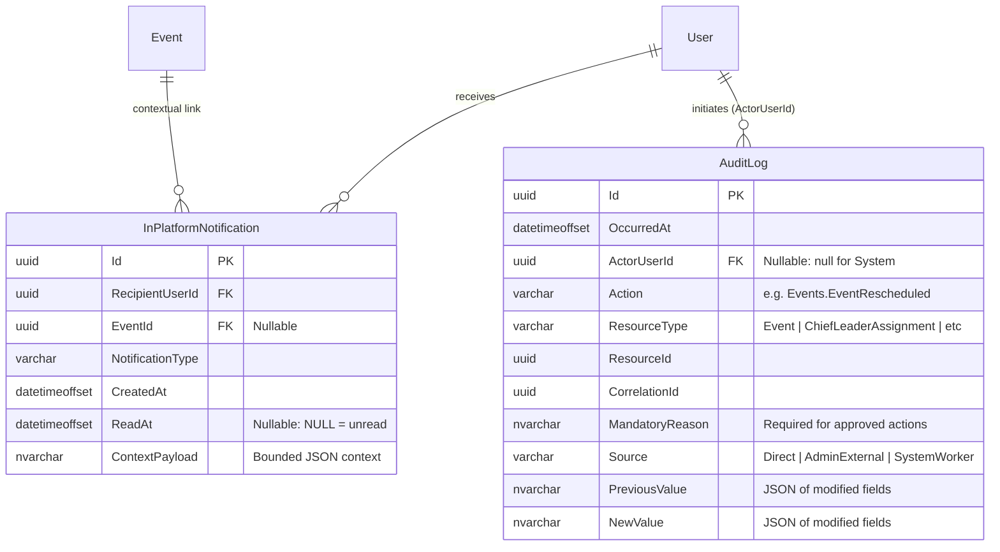
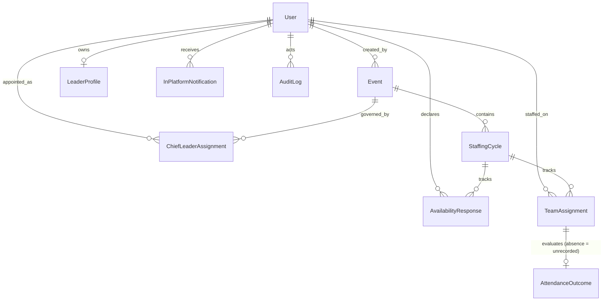

# Carpediem Core Entity-Relationship Diagram (ERD)

> [!IMPORTANT]
> **Status: ARCHITECTURAL BASELINE / PENDING DATA DESIGN REVIEW**  
> **Database Engine**: Microsoft SQL Server 2025  
> **Precedence**: Visual and structural representation of the authoritative logical data model and relational schema specifications.

---

## 1. Overview & Diagram Decomposition

To maintain visual clarity, the relational model is decomposed into three focused domain ERDs followed by an end-to-end cross-module relationship map:

1. **Core Operational ERD**: `events.Events`, `events.StaffingCycles`, `events.ChiefLeaderAssignments`, `staffing.AvailabilityResponses`, `staffing.TeamAssignments`, and `attendance.AttendanceOutcomes`.
2. **Identity & Profile ERD**: `identity.Users`, `identity.Roles`, `identity.UserRoles`, and `leader.LeaderProfiles`.
3. **Cross-Cutting Audit & Notifications ERD**: `audit.AuditLogs` and `notifications.InPlatformNotifications`.
4. **Cross-Module Unified Relationship Map**: Complete high-level system entity relationships and cardinalities.

---

## 2. Diagram 1: Core Operational ERD (Events, Staffing & Attendance)

---

## 3. Diagram 2: Identity, Roles & Leader Profile ERD

---

## 4. Diagram 3: Cross-Cutting Audit & Notifications ERD

---

## 5. Diagram 4: Cross-Module Relational Flow & Cardinality Map

---

## 6. Key Relational Invariants Illustrated in the Diagrams

1. **At Most One Current Staffing Cycle**: An `Event` has zero or more historical `StaffingCycles`, but at most one with `IsCurrent = 1` (enforced via filtered unique index). Domain rules ensure at least one upon publication.
2. **Current Operational Assignment Scope**: An assignment is currently operational only if `TeamAssignment.Status = 'Active'` AND `StaffingCycle.IsCurrent = 1`.
3. **At Most One Active Chief Leader**: An `Event` can have multiple historical `ChiefLeaderAssignments` (`Declined`), but at most one with `Status = 'Active'`.
4. **No Double-Staffing on Roster**: A volunteer Leader can have at most one `TeamAssignment` with `Status = 'Active'` within the same `StaffingCycle`.
5. **Pure Absence Attendance**: Unrecorded attendance is represented by the absence of an `AttendanceOutcome` row. Persisted rows exist only for `Attended` or `NoShow`.
6. **Historical Integrity Preservation**: All cross-module foreign keys use `ON DELETE NO ACTION`. Cancelled team assignments and declined leadership appointments are preserved as historical records and not destructively overwritten during normal business workflows.
