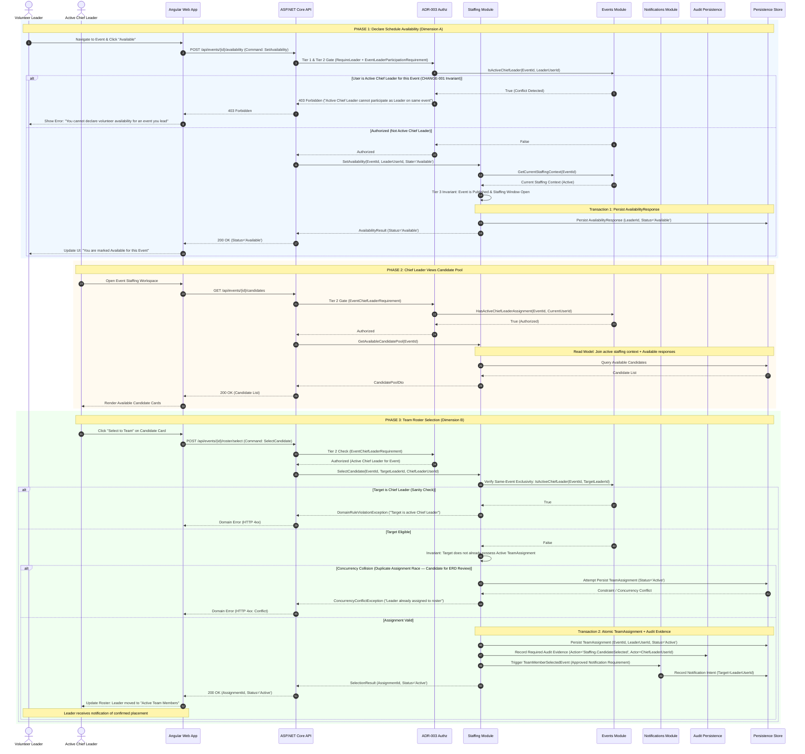

# Sequence 002: Leader Availability Declaration, Candidate Pooling & Team Selection

* **Context**: Volunteer availability collection and Chief Leader team roster selection for a published event.
* **Lifecycle Transitions Covered**:
  - `AvailabilityResponse` (Dimension A): `[No Record]` $\rightarrow$ `Available`
  - `TeamAssignment` (Dimension B): `[No Record]` $\rightarrow$ `Active`
* **Authoritative Inputs**:
  - `LIFECYCLE_SPECIFICATION.md` (Sections 4 & 5)
  - `CHANGE-001` (Chief Leader Dual-Role Participation & Same-Event Exclusivity)
  - `ADR-002` (Authentication & Session Strategy)
  - `ADR-003` (Authorization: Tier 1, Tier 2, Tier 3)
  - `ADR-005` (Audit Trail Strategy)
  - `ADR-009` (SQL Server Persistence & Schema Organization)

---

## 1. Sequence Overview

This sequence details the two distinct dimensions of event staffing:
1. **Dimension A: Availability Declaration**:
   - A volunteer Leader views a `Published` Event.
   - The Leader submits affirmative availability (`Available`).
   - The system validates that the user possesses the `Leader` role and is **not** the active Chief Leader for this same event (per CHANGE-001).
   - An `AvailabilityResponse` record in status `Available` is persisted for the current active staffing context. Absence of response was previously treated as `No Record` (displayed as "Response Needed" in UI).
2. **Candidate Pooling**:
   - The candidate pool for the Chief Leader dynamically derives from all volunteer Leaders who have submitted an `Available` response for the event's current active staffing context.
3. **Dimension B: Team Selection**:
   - The assigned Chief Leader (holding an `Active` `ChiefLeaderAssignment` for this specific event) views the candidate pool and selects an available Leader.
   - The `Staffing` module immediately creates an `Active` `TeamAssignment`.
   - **Immediate Placement (Approved Rule)**: There is no secondary invitation or confirmation queue; selection immediately establishes official, operational team membership.
   - **Notification (Approved Requirement)**: The selected Leader receives an in-platform notification confirming placement.
4. **Dimension Decoupling**:
   - The `AvailabilityResponse` remains `Available` (it is not deleted, mutated, or converted into an assignment). Both dimensions coexist independently.

---

## 2. Sequence Diagram

---

## 3. Architecture & Boundary Analysis

### A. Authorization Points (ADR-003)
1. **Set Availability (Step 3)**: Tier 1 `RequireRole("Leader")` + Tier 2 `EventLeaderParticipationRequirement`. Verifies that the volunteer holds the `Leader` role capability AND is not currently the active Chief Leader on this specific event.
2. **Candidate Review & Selection (Step 18 & 31)**: Tier 2 `EventChiefLeaderRequirement`. Verifies that the actor has an `Active` `ChiefLeaderAssignment` for the target Event.

### B. Domain Invariants & Guard Checks
1. **Same-Event Exclusivity (CHANGE-001)**: $\text{ActiveChiefLeaderAssignment}(E, U) \implies \neg\text{ActiveTeamAssignment}(E, U)$. A user cannot submit availability for an event they are actively leading, nor can they be placed on the volunteer team roster.
2. **Immediate Active Assignment**: When a candidate is selected, the `TeamAssignment` is created directly in `Active` status. No intermediate invitation, staging, or secondary confirmation state exists.
3. **Decoupled Dimensions**: The Leader's `AvailabilityResponse` remains recorded as `Available`. The new `TeamAssignment` is recorded independently. Neither record overwrites or erases the other.

### C. Concurrency-Sensitive Points (ERD Review Candidates)
- **Roster Slot & Duplicate Assignment Race**: Invariant: at most one `Active` `TeamAssignment` for the same Leader/Event context. Potential SQL enforcement mechanisms (e.g., unique filtered indexes or rowversion concurrency tokens) will be formally evaluated during the ERD review.

### D. Transaction Boundaries & Atomicity
- **Transaction 1 (Availability Submission)**: Persists `AvailabilityResponse` bound to current staffing context.
- **Transaction 2 (Team Selection)**: Atomically commits the new `TeamAssignment` (`Active`) and records required audit evidence.
- *Notification intent*: Triggered as part of the successful workflow. Reliable notification delivery mechanics are governed by ADR-006.
