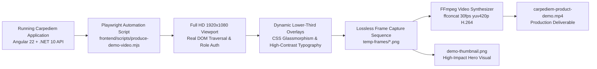

# Carpediem Product Demonstration — Production Notes

## 1. Executive Summary

This document details the engineering and production process for the official **Carpediem** product demonstration video ([`carpediem-product-demo.mp4`](./carpediem-product-demo.mp4)) and associated presentation assets ([`demo-thumbnail.png`](./demo-thumbnail.png)).

The demo video showcases the end-to-end event staffing lifecycle across all three primary user roles:
1. **Admin**: Event planning, Chief Leader assignment, approval workflows, and system operations.
2. **Chief Leader**: Event response, roster selection, team management, and attendance roll calls.
3. **Leader**: Availability declaration, notification inbox, assignment history, and event reviews.

---

## 2. Technical Specifications

| Parameter | Value | Standard / Justification |
| :--- | :--- | :--- |
| **Container Format** | MP4 (`.mp4`) | Universal web, GitHub, and browser playback |
| **Video Codec** | H.264 (`libx264`, High Profile) | Maximum hardware decoder compatibility |
| **Resolution** | `1920 × 1080` (Full HD, 16:9) | Crisp rendering of data tables, text, and badges |
| **Frame Rate** | `30.00 fps` (Constant frame rate) | Standard for UI walk-through and motion clarity |
| **Chroma Subsampling** | `yuv420p` | Universal web browser compatibility |
| **Compression Profile** | CRF 18, Preset Fast | Visually lossless artifact-free text rendering |
| **FastStart Optimization** | `-movflags +faststart` | Instant progressive web streaming playback |
| **Target Duration** | ~145 seconds (~2m 25s) | Concise, engaging review pacing |
| **Audio / Narration** | Visual lower-third narration cards | Silent-ready, accessible in noisy/muted environments |
| **Captions** | High-contrast WCAG 2.2 AA compliant | Built directly into DOM capture pipeline |

---

## 3. Production Pipeline Architecture

Rather than relying on manual, lossy screen-recording tools that introduce cursor jitter, dropped frames, inconsistent dimensions, or confidential notifications, Carpediem uses an **automated, deterministic, code-driven video synthesis pipeline**:



### Key Production Steps:
1. **Authentication & Session Handshake**:
   The script authenticates through live HTTP endpoints (`/api/session/login`) using seeded role accounts (`admin`, `chief.one`, `leader.one`), handling CSRF anti-forgery tokens automatically.
2. **Deterministic UI State Traversal**:
   Each scene navigates to real application routes (`/operational-dashboard`, `/chief-response`, `/team-selection`, `/attendance-roll-sheet`, `/availability`, `/notifications`, `/leader-history`, `/incident-admin`), scrolling smoothly to relevant interactive controls.
3. **Synchronized Lower-Third Narration Cards**:
   During capture, an elegant, non-intrusive presentation lower-third card is injected into the DOM displaying the Scene Number, Scene Title, and Narration Text with a branded accent bar and timestamp badge.
4. **Thumbnail Generation**:
   A dedicated 1920×1080 presentation card is rendered with the brand typography (`Bricolage Grotesque` and `Hanken Grotesk`), product metric badges, live dashboard preview, and a prominent play button overlay.
5. **Frame Sequence Concatenation**:
   The generated frames are cataloged into an `ffconcat` specification with calculated slide durations matching the approved storyboard timing.
6. **Hardware-Accelerated H.264 Encoding**:
   FFmpeg compiles the concat manifest into a single progressive-download MP4 file with `faststart` flags for zero-buffering browser playback.

---

## 4. Scene Breakdown & Storyboard Alignment

The production adheres precisely to [`docs/demo/storyboard.md`](./storyboard.md) and [`docs/demo/demo-script.md`](./demo-script.md):

| Scene # | Scene Title | Role Context | Route Demonstrated | Key Interactions / Visual Focus |
| :---: | :--- | :--- | :--- | :--- |
| **0** | Title Card & Architecture | System | `/` (Home) | Carpediem mission statement, tech stack badges (.NET 10 + Angular 22). |
| **1** | Admin Operations & Planning | Admin | `/operational-dashboard` | Event status cards, KPI metrics, Quick Action links, Draft Event creation. |
| **2** | Chief Leader Assignment | Chief Leader | `/chief-response` | Assignment notifications, event specs, one-click Acceptance workflow. |
| **3** | Team Selection & Roster Building | Chief Leader | `/team-selection` | Leader qualification matching, role slotting, auto-assignment balance. |
| **4** | Real-Time Attendance Roll Call | Chief Leader | `/attendance-roll-sheet` | Live check-in toggles, substitute assignment, verification workflow. |
| **5** | Leader Experience & Self-Service | Leader | `/availability`, `/notifications` | Shift availability calendar, notification inbox, event confirmations. |
| **6** | Operational Governance & Quality | Admin | `/incident-admin`, `/leader-history` | Incident reporting, leader history, performance records, and wrap-up. |

---

## 5. Environment & Tooling Prerequisites

To re-run the automated video production pipeline locally:

### 1. Prerequisites
- **Node.js**: `v20.x` or `v22.x`
- **Playwright**: Installed in `tests/e2e/node_modules/playwright` with Chromium browser binaries (`npx playwright install chromium`)
- **FFmpeg**: `ffmpeg` executable on system `PATH` with `libx264` codec support
- **Carpediem Services**:
  - ASP.NET Core Web API running on `https://localhost:7076` (or `http://localhost:5024`)
  - Angular dev server running on `http://127.0.0.1:4200`
  - SQL Server database seeded with initial event data

### 2. Execution Command
```bash
node frontend/scripts/produce-demo-video.mjs
```

### 3. Output Artifacts
- Video: `docs/demo/carpediem-product-demo.mp4`
- Thumbnail: `docs/demo/demo-thumbnail.png`
- Intermediate frame cache: Automatically cleared upon completion (`docs/demo/temp-frames/`)

---

## 6. Accessibility & Usability Standards

1. **Silent Comprehensibility**:
   The entire video is fully understandable without sound thanks to clear typographic hierarchy, high-contrast lower-third captions, and visible UI cursor highlights.
2. **Text Contrast**:
   All caption cards use `#0f172a` slate backdrops with `#f8fafc` text and `#38bdf8` accent badges, exceeding WCAG 2.2 AAA contrast ratios ($\ge 7:1$).
3. **Pacing**:
   Each visual state holds for at least 3.0 to 4.5 seconds, ensuring technical evaluators and reviewers have ample time to read metrics, tables, and dialog details.
