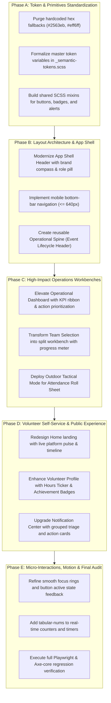

# Carpediem UI & Design System Masterpiece Report
## Architectural Blueprint for Elevated Visual Identity, Field Ergonomics, and Design System Maturity

**Author**: Senior Design Lead & UI Architect  
**Evaluation Date**: October 23, 2026  
**Status**: Strategic Action Plan  
**Target Milestone**: Masterpiece-Grade Open Source Volunteer Orchestration Platform  

---

## 1. Executive Design Appraisal & Creative Direction

### 1.1 Current State Assessment
Carpediem has achieved a robust engineering baseline:
- Strict **WCAG 2.2 AA** accessibility compliance with zero automated Axe-core violations.
- A functional custom SCSS design token foundation in `design-system/styles/`.
- Distinctive open typography utilizing **Bricolage Grotesque** and **Hanken Grotesk**.
- Clean mobile reflow across viewports down to 320px.

However, from the perspective of elite product design, the interface currently exhibits classic symptoms of **"functional prototype syndrome"** and generic templates:
1. **The SaaS Card Kit Trap**: Every page chops its contents into identical rounded panels (`background: var(--cd-bg-surface); border: 1px solid var(--cd-border-default); border-radius: var(--cd-radius-panel);`). Content feels packaged rather than structured.
2. **Template Chrome & Repetitive Tropes**:
   - Tracked-out, uppercase eyebrow labels (`.eyebrow`) appear above virtually every heading across 15+ components.
   - Middle-dot string concatenation (`A · B · C`) is used for metadata instead of structured key-value alignment.
   - Identical button groupings and card actions regardless of urgency or context.
3. **Fragmented Component Classes**: Buttons are styled under `.primary`, `.cd-btn--primary`, `.btn-primary`, `.btn-action`, and `.btn-select` across different feature modules. Alerts, badges, and empty states similarly diverge across 5+ independent implementations.
4. **Flat Informational Density**: Critical operational interfaces (Team Selection, Operational Dashboard, Attendance Roll Sheet) display data with uniform weight. Chief Leaders coordinating teams in the field cannot scan at a glance to identify staffing deficits, active no-shows, or immediate time constraints.
5. **Leftover Hardcoded Fallbacks**: Several SCSS files retain legacy `#2563eb`, `#eff6ff`, `#065f46`, and `#fff` hex fallbacks bypassing the semantic token pipeline.

---

### 1.2 The Masterpiece Vision: "Civic Dispatch & Community Stewardship"
Carpediem is not an enterprise HR tool or a generic project management board. It is a **civic orchestration platform** for real-world events—festivals, emergency responses, beach cleanups, and community initiatives. 

The master design direction takes inspiration from:
- **Municipal Dispatch & Field Guides**: Utilitarian, unmistakable clarity, high-contrast typography, and immediate tactical comprehension under pressure.
- **Modern Swiss Editorial Typography**: Precise grid alignment, intentional asymmetry, generous white space, disciplined hierarchy, and type used as a structural visual element.
- **Civic Warmth & Quiet Confidence**: Grounded in deep forest green (`#1d5041`), warm paper canvas (`#f8f9f5`), rich evergreen ink (`#15281d`), with deliberate warning amber and crisis red signals that demand attention without inducing panic.

```
+---------------------------------------------------------------------------------------+
|  CARPEDIEM  [● LIVE DISPATCH]               Operations  ·  Drafts  ·  (Admin) Sarah   |
+---------------------------------------------------------------------------------------+
|  [COMMUNITY CLEAN-UP]                                         TIMELINE: ROSTER LOCKED |
|  Saturday, Oct 24, 2026 · 08:00 – 16:00 Cairo               Fulfillment: 14/15 (93%)  |
+-------------------------------------------+-------------------------------------------+
|  AVAILABLE POOL (12 candidates)           |  ACTIVE ROSTER (14 assigned · 1 deficit)  |
|  [Filter by qualification: Medical / Log] |                                           |
|  ---------------------------------------  |  TEAM LEAD                                |
|  [+] Alice Smith (Logistics, 42h)         |  ● Sarah Jenkins (Chief Leader)           |
|  [+] David Miller (Crowd Control, 18h)    |  FIRST AID                                |
|  [+] Omar Hassan (First Aid, 64h)         |  ● Karim Mansour                          |
|                                           |  CROWD MARSHALS                           |
|                                           |  [!] 1 Slot Open [Auto-Fill Suggestion]   |
+-------------------------------------------+-------------------------------------------+
```

---

## 2. Core Architectural Enhancement Areas

### Area 1: Design System & Token Consolidation
**Problem**: The design tokens in `design-system/styles/` define primitive variables, but lack an abstracted component layer. Features reinvent buttons, badges, tables, and dialogs in their local SCSS files.

#### Architectural Enhancements:
1. **Unified Design System Component Library (`design-system/components/`)**:
   - `cd-button`: Variants (`primary`, `secondary`, `subtle`, `destructive`), sizes (`sm`, `md`, `lg`), with explicit interactive state styling (hover, active, focus-visible, disabled, loading).
   - `cd-badge`: Semantic status tokens (`info`, `success`, `warning`, `critical`, `neutral`), supporting count badges, role pills, and lifecycle indicators.
   - `cd-callout / cd-alert`: Inline notifications with semantic icon indicators, dismiss triggers, and clear typography.
   - `cd-metric-card`: Structured KPI blocks with large tabular numbers, trend indicators, and label pairings.
   - `cd-data-table`: Accessible, dense tabular views for rosters, accounts, and audit records with sticky column headers and responsive card reflow.
2. **Purge Remaining Hex Fallbacks**:
   - Replace `#2563eb` and `#eff6ff` in `availability-declaration.component.scss` with `--cd-status-info-fg` and `--cd-status-info-bg`.
   - Replace `#065f46`, `#f3f4f6`, and `#fff` in `volunteer-assignment.component.scss` with official `--cd-action-primary-hover`, `--cd-bg-subtle`, and `--cd-text-inverse`.
3. **Formal State Token Specifications**:
   - Define `--cd-surface-hover`, `--cd-surface-pressed`, `--cd-border-focus`, and `--cd-shadow-elevation-1` through `3`.

---

### Area 2: Layout & Information Architecture Hierarchy
**Problem**: The application relies heavily on uniform single-column card stacks. Complex operational workflows lack clear primary visual focal points.

#### Architectural Enhancements:
1. **The Unified Event Lifecycle Header ("Operational Spine")**:
   Every event-centric route (`/team-selection`, `/attendance`, `/replacement-assignment`, `/reschedule`, `/complete`) must render a standardized, elegant Operational Spine:
   - Event Title & Venue location.
   - Five-stage visual breadcrumb/progress spine: `Draft ➔ Published ➔ Staffed ➔ In Progress ➔ Completed`.
   - Local Cairo date/time badge with relative countdown (e.g., *"Starts in 3 hours"* or *"Live Now"*).
   - Core operational vitals: Current fulfillment percentage ($14/15$ slots) and assigned Chief Leader avatar/identity.
2. **Asymmetric Workbench Layouts**:
   - On desktop viewports ($\ge 1024\text{px}$), transition from vertical card stacks to split-pane workbenches (e.g. Left: Context & Filtered Queue; Right: Live Canvas / Roster).
3. **Elimination of Template Chrome**:
   - Remove generic uppercase `.eyebrow` labels above every title. Replace with meaningful context: breadcrumbs with parent context (e.g., `Events / Alexandria Coastal Cleanup / Staffing`).

---

### Area 3: Field-Grade Tactical Ergonomics
**Problem**: Chief Leaders and field volunteers use mobile devices outdoors in high-glare sunlight, unpredictable connectivity, and time-critical conditions.

#### Architectural Enhancements:
1. **High-Legibility Outdoor Contrast Tokens**:
   - Boost font weight of tabular figures and data labels from 400 to 500/600.
   - Use high-contrast border definition (`--cd-border-strong: #64746d`) for interactive touch surfaces.
2. **Tactile Large Toggles & Rapid Roll Call**:
   - Attendance roll sheet should support **"Rapid Attendance Mode"**:
     - Large, edge-to-edge touch targets ($\ge 56\text{px}$ height on mobile).
     - Clear color fills (Attended: Emerald `#15803d` with white text; No-Show: Crimson `#b91c1c` with white text; Unrecorded: Soft amber outline).
     - Haptic-ready visual feedback when tapping outcomes.
3. **Immediate Status Scanning**:
   - Cards on the Operational Dashboard must be color-coded on their leading edge or status bar:
     - Urgent Attention (Pending Attendance / Unstaffed Gaps): Amber alert bar.
     - Live Event in Progress: Pulsing dispatch indicator dot.
     - Safely Concluded: Calming neutral check.

---

### Area 4: Forms, Validation & Data Entry Craft
**Problem**: Current forms display generic stacked text inputs with plain validation messages popping up below the fields.

#### Architectural Enhancements:
1. **Crafted Form Fieldsets**:
   - Input containers with subtle inset borders, clear focus rings that do not obscure neighboring content.
   - Persistent helper text and real-time character meters for justification textareas (`24/250 characters entered`).
2. **Context-Preserving Validation**:
   - Inline field errors with clear, active voice guidance (e.g., *"End time must be after start time (minimum 30 minutes)"*).
3. **Sticky Action Bars with Backdrop Blur**:
   - Fixed/sticky form footer actions (such as in Draft Create/Edit) should use `backdrop-filter: blur(8px); background: rgba(255, 255, 255, 0.92);` with a top divider line, ensuring primary buttons are always within thumb reach without hiding scrollable form content.

---

### Area 5: Typography Discipline & Editorial Pacing
**Problem**: Typography is clean, but lacks the intentional hierarchy of an editorial masterpiece.

#### Architectural Enhancements:
1. **Typographic Scale & Hierarchy**:
   - Use `Bricolage Grotesque` exclusively for key display anchors (Page H1s, Major Hero Statements, Critical KPI numbers).
   - Use `Hanken Grotesk` with tight letter spacing for UI controls, data tables, and body copy.
   - Strict character limit on prose lines (`max-inline-size: 65ch` instead of raw pixels), improving readability on desktop.
2. **Tabular Numerics for Metrics**:
   - Enable `font-variant-numeric: tabular-nums` across all counters, roll call tallies, and timestamps, preventing layout jitter during real-time updates.

---

## 3. Screen-by-Screen Detailed Enhancement Catalog

### 3.1 Public & Authentication Experience

#### Screen 1: App Shell & Global Navigation Header
- **Current State**: Standard flex header with brand link on the left and horizontal nav items on the right. Collapses to a plain vertical stack on mobile.
- **Enhancement Plan**:
  - **Brand Visual Anchor**: Modernize the brand mark into a bespoke geometric compass/sun logo symbol representing "Carpe Diem" (seize the day / community leadership).
  - **Role Badge**: Replace plain text `admin` with a structured pill: `Admin`, `Chief Leader`, or `Volunteer` with subtle role-specific tint.
  - **Notification Bell**: Display a bell icon with dynamic badge count that animates subtly on change.
  - **Mobile Drawer / Bottom Navigation**: On mobile screens ($\le 640\text{px}$), replace the awkward multi-line text header with a sleek top header (Brand + Notification icon + Avatar) and an ergonomic bottom tab bar (`Home`, `Dashboard`, `Roster`, `Profile`).

#### Screen 2: Landing / Home Page (`pages/home.component.ts`)
- **Current State**: Generic hero card with an uppercase eyebrow, paragraph, and 3 identical role cards in a grid.
- **Enhancement Plan**:
  - **Editorial Hero Section**: Replace the generic hero card with an inspiring, civic headline: *"Empower community action through precision event coordination."*
  - **Live Operational Snapshot**: Render a real-time status ticker showing live platform vitals: *3 Events in Progress · 48 Volunteers On Duty · 98.4% Staffing Fulfillment*.
  - **Interactive Lifecycle Stepper**: Replace the static 3-card role grid with an interactive event progression preview:
    1. *Admin defines staffing blueprint*
    2. *Chief Leader builds qualified roster*
    3. *Volunteers confirm & execute on-site*

#### Screen 3: Sign-In & Leader Registration (`pages/sign-in.component.ts`, `accounts/register.component.ts`)
- **Current State**: Plain stacked form inputs on a white card.
- **Enhancement Plan**:
  - **Split-Screen Layout (Desktop)**: Left side features an authentic community event visual or inspirational quote on volunteer leadership; right side hosts the focused, distraction-free authentication card.
  - **Live Validation Meters**: Real-time password strength meter and instant email format verification.
  - **Trust & Privacy Reassurance**: Security badge reassuring users that personal contact information is only shared with appointed Chief Leaders during active events.

---

### 3.2 Operational Management (Administrator Experience)

#### Screen 4: Operational Dashboard (`operational-dashboard.component.*`)
- **Current State**: Grid of identical cards, each with up to 7 buttons packed at the bottom.
- **Enhancement Plan**:
  - **Executive Status Bar**: Top ribbon summarizing key metrics:
    - *Draft Planning (3)* · *Active Staffing (5)* · *Pending Attendance (2)* · *Completed (14)*.
  - **Interactive Filter Chips**: One-click pills to filter by lifecycle stage (`All`, `Requires Action`, `Published`, `Drafts`, `Concluded`).
  - **Card Visual Hierarchy**:
    - Emphasize the single **Next Recommended Action** as a prominent primary button (e.g., if attendance is pending, the prominent button is `Open Roll Sheet`).
    - Move secondary administrative actions (Reschedule, Cancel, Incidents) into a subtle three-dot context menu or secondary utility row.
    - Add a visual progress ring showing current roster capacity (e.g. $12/15$ slots filled).

#### Screen 5: Draft Events List & Authoring (`draft-events/*`)
- **Current State**: Standard list of cards linking to edit form.
- **Enhancement Plan**:
  - **Table View with Column Sorting**: Switchable list/table view showing Title, Venue, Start Time (Cairo), Target Roster, and Chief Leader status.
  - **Cairo Timezone Converter Visualizer**: In the authoring form, provide an interactive timeline showing the Cairo local time alongside UTC and standard working hours, preventing scheduling mistakes.
  - **Role Demand Builder**: A tactile role slot counter allowing admins to add roles (e.g. *Medical Lead: 2*, *Crowd Marshal: 6*, *Logistics: 4*) with instant total calculation.

#### Screen 6: Account Administration (`accounts/account-admin.component.*`)
- **Current State**: Cards with checkboxes for roles and an approve button.
- **Enhancement Plan**:
  - **Dense Governance Table**: High-density table with searchable username/email filter.
  - **Role Pill Toggles**: Interactive pill chips for `Leader`, `Chief Leader`, and `Admin` that toggle with a single click.
  - **Batch Actions**: Multi-select capability to approve or reactivate multiple verified volunteers simultaneously.

#### Screen 7: Incident & Feedback Administration (`engagement/*`)
- **Current State**: Plain card feed of incidents with a review textarea.
- **Enhancement Plan**:
  - **Severity Triage Badges**: Color-coded severity tiers (`Low`, `Medium`, `High`, `Critical / Safety`).
  - **Chronological Timeline**: Display incident occurrence vs report time to assess reporting speed.
  - **Resolution Drawer**: Clicking an incident opens a clean side-sheet drawer with complete event context, reporter contact details, and resolution history.

---

### 3.3 Field Leadership (Chief Leader Experience)

#### Screen 8: Chief Leader Appointment & Response (`chief-leader-appointment/*`, `chief-leader-response/*`)
- **Current State**: Form with radio buttons and candidate cards.
- **Enhancement Plan**:
  - **Formal Delegation Letter Card**: When a Chief Leader opens their invitation, present the event as an official mission brief:
    - Expected team size, venue location, schedule, and primary responsibilities.
    - Two prominent, unmistakable actions: `Accept Leadership` (Forest Green) and `Decline Appointment` (Subtle outline).

#### Screen 9: Team Selection & Roster Management (`team-selection/*`)
- **Current State**: Three stacked sections (Active Roster, Available Pool, Direct Draft Pool) on a single scrollable page.
- **Enhancement Plan**:
  - **Split Workbench (Desktop)**:
    - **Left Column**: Qualified Volunteer Pool (with search by name, skill tags, and accumulated service hours).
    - **Right Column**: Active Team Roster slotted into defined roles with a live fulfillment meter ($14/15$ filled).
  - **Drag-and-Drop or One-Click Slotting**: Immediate visual confirmation when a volunteer moves from Available to Active.
  - **Direct Draft Warning Badge**: Direct draft pool candidates clearly flagged with reason pills (*"Non-Respondent"* or *"Declined Availability"*) so chiefs know whom they are drafting.

#### Screen 10: On-Site Attendance Roll Call (`attendance-roll-sheet/*`)
- **Current State**: List of volunteers with two toggle buttons (`Attended` / `No Show`).
- **Enhancement Plan**:
  - **High-Contrast Tactical Mode**: Optimized for bright outdoor sunlight with high-contrast text and border weights.
  - **Quick Action Bar**:
    - Sticky top bar with large counter: `14 Attended · 1 No Show · 0 Pending`.
    - One-tap `Mark All Remaining Attended` confirmation.
  - **Inline Substitute Assignment**: If a volunteer is marked `No Show`, an immediate inline prompt appears: `Assign Replacement Volunteer`.

#### Screen 11: Emergency Replacement Assignment (`replacement-assignment/*`)
- **Current State**: Table of staffing gaps with available substitute list.
- **Enhancement Plan**:
  - **Staffing Deficit Callout**: Prominent amber alert banner highlighting exact vacant role slots that need immediate coverage.
  - **Smart Matching Rank**: Order available candidates by relevant experience, proximity, and past attendance reliability.

---

### 3.4 Volunteer Leader Experience

#### Screen 12: Availability Declaration (`availability/*`)
- **Current State**: Card with `Mark Available` and `Mark Not Available` buttons.
- **Enhancement Plan**:
  - **Shift Calendar Visualizer**: Visual representation of the shift duration against a daily timeline.
  - **Immediate Confirmation State**: When clicking `Mark Available`, the button transforms into a verified check with a warm encouragement note (*"Thank you! The Chief Leader will finalize rosters by Thursday."*).
  - **Availability Note Input**: An optional field for volunteers to indicate transport constraints or role preferences.

#### Screen 13: Notification Center (`notifications/*`)
- **Current State**: Simple unread list with text details and a mark-as-read button.
- **Enhancement Plan**:
  - **Categorized Triage**: Chronological grouping: `Today`, `This Week`, `Older`.
  - **Action-Oriented Cards**: Instead of just text, each notification provides a direct context action:
    - *"You were selected for Community Cleanup"* ➔ Direct button: `View Shift Details`.
    - *"Event Rescheduled"* ➔ Direct button: `Update Availability`.

#### Screen 14: Leader Profile & Service History (`leader-history/*`, volunteer assignment)
- **Current State**: Plain list of past assignments with status.
- **Enhancement Plan**:
  - **Volunteer Achievement Showcase**:
    - **Total Hours Contributed**: Big, bold tabular metric with leaf/heart community icon.
    - **Attendance Reliability Rate**: e.g., `100% Reliability (12/12 shifts completed)`.
    - **Role Badges**: Badges earned through field experience (`First Aid Certified`, `Logistics Specialist`, `Senior Marshal`).
  - **Downloadable Service Certificate Preview**: Button to generate a signed PDF record of volunteer hours for school, employer, or civic credit.

---

### 3.5 Dialogs, Governance & Modals

#### Screen 15: Event Reschedule, Completion, and Cancellation Dialogs
- **Current State**: CDK modal dialogs with basic form controls.
- **Enhancement Plan**:
  - **Impact Analysis Summary**: Before confirming a reschedule or cancellation, the dialog displays an automatic impact summary:
    - *Affects 1 Chief Leader and 14 Confirmed Volunteers. Automated notifications will be dispatched immediately.*
  - **Distinctive Modal Backdrop**: Soft tinted backdrop (`backdrop-filter: blur(4px); background: rgba(21, 40, 29, 0.45);`) that elevates the dialog into focus.
  - **Destructive Warning Aesthetics**: For cancellation, use dedicated crimson borders and clear confirmation phrases (*"Type CANCEL to confirm"* for irreversible actions).

---

## 4. Master Design Token Specification

Below is the consolidated, Figma-ready design token architecture to be added to the design system foundation:

```scss
// =============================================================================
// CARPEDIEM MASTER TOKEN SYSTEM (CIVIC DISPATCH & CRAFT)
// =============================================================================

:root {
  // Brand Palette: Deep Forest & Warm Earth
  --cd-brand-forest-900: #0d261e;
  --cd-brand-forest-800: #153c30;
  --cd-brand-forest-700: #1d5041; // Primary Brand
  --cd-brand-forest-600: #266b57;
  --cd-brand-forest-100: #eaf2ed;
  --cd-brand-forest-50:  #f4f8f5;

  // Warm Paper Canvas & Ink
  --cd-canvas-paper:     #f8f9f5; // Warm background
  --cd-surface-pure:     #ffffff; // Card and panel surfaces
  --cd-surface-muted:    #f0f2ec; // Secondary utility surfaces
  --cd-ink-primary:      #15281d; // High-contrast evergreen text
  --cd-ink-secondary:    #4a5b51; // Balanced secondary text
  --cd-ink-muted:        #78897f; // De-emphasized metadata

  // Tactical Status Palette
  --cd-signal-success:   #15803d; // Emerald check
  --cd-signal-success-bg:#f0fdf4;
  --cd-signal-warning:   #b45309; // Amber attention
  --cd-signal-warning-bg:#fffbeb;
  --cd-signal-danger:    #b91c1c; // Crimson alert
  --cd-signal-danger-bg: #fef2f2;
  --cd-signal-info:      #0369a1; // Dispatch cyan
  --cd-signal-info-bg:   #f0f9ff;

  // Elevation & Surface Depth
  --cd-shadow-sm:        0 1px 2px 0 rgb(21 40 29 / 0.05);
  --cd-shadow-md:        0 4px 6px -1px rgb(21 40 29 / 0.08), 0 2px 4px -2px rgb(21 40 29 / 0.05);
  --cd-shadow-lg:        0 10px 15px -3px rgb(21 40 29 / 0.1), 0 4px 6px -4px rgb(21 40 29 / 0.05);
  --cd-shadow-modal:     0 20px 25px -5px rgb(21 40 29 / 0.15), 0 8px 10px -6px rgb(21 40 29 / 0.1);

  // Micro-Radii (Structured, Crisp, Swiss Utility)
  --cd-radius-xs:        0.25rem;
  --cd-radius-sm:        0.375rem;
  --cd-radius-md:        0.5rem;   // Controls and buttons
  --cd-radius-lg:        0.75rem;  // Containers and panels
  --cd-radius-full:      9999px;   // Status pills

  // Layout Rhythms
  --cd-content-max:      76rem;    // 1216px maximum container
  --cd-reading-max:      65ch;     // Maximum line length for prose
  --cd-touch-min:        44px;     // Strict WCAG touch target floor
}
```

---

## 5. Strategic Implementation Roadmap



---

## 6. Summary of Actionable Next Steps

| Work Item | Target File(s) | Priority | Impact |
| :--- | :--- | :---: | :--- |
| **Cleanse Stray Hex Values** | `availability-declaration.component.scss`, `volunteer-assignment.component.scss` | **P0** | Design system token purity |
| **Operational Spine Component** | `frontend/src/app/shared/components/operational-spine/` | **P1** | Cohesive cross-workflow navigation |
| **Dashboard Action Prioritization** | `operational-dashboard.component.html`, `.scss` | **P1** | Reduced cognitive load for coordinators |
| **Team Selection Workbench** | `team-selection.component.html`, `.scss` | **P1** | Fast candidate slotting for Chief Leaders |
| **Attendance Tactical Mode** | `attendance-roll-sheet.component.html`, `.scss` | **P1** | Outdoor sunlight usability for roll calls |
| **Volunteer Service Metrics** | `leader-history.component.html`, `.scss` | **P2** | Volunteer recognition and pride |
| **Home Page Narrative** | `home.component.ts` | **P2** | First-impression showcase aesthetic |

---
*Report authored with precision for Carpediem design leadership.*
