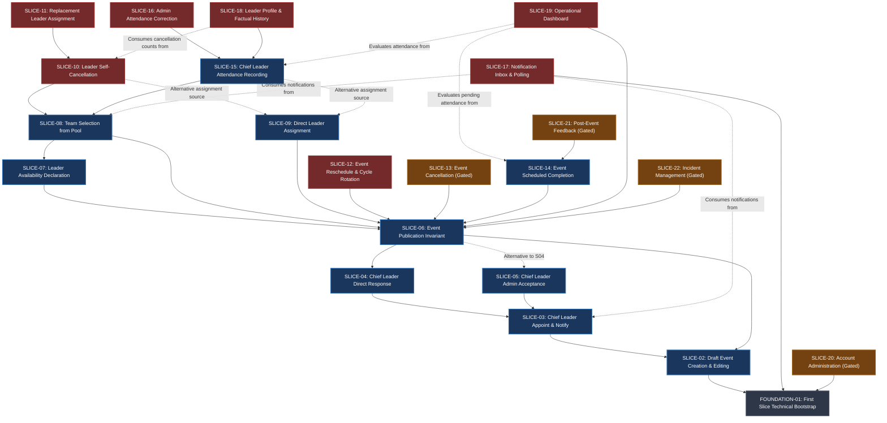

# Carpediem V1 Feature Dependency Graph

> [!IMPORTANT]
> **Governance Status**: Authoritative Architecture Dependency Specification  
> **Precedence**: Aligned strictly with [ARCHITECTURE_LOCK.md](file:///c:/dev/web/Carpediem/docs/architecture/ARCHITECTURE_LOCK.md), [LIFECYCLE_SPECIFICATION.md](file:///c:/dev/web/Carpediem/docs/requirements/LIFECYCLE_SPECIFICATION.md), and [V1_FEATURE_SLICES.md](file:///c:/dev/web/Carpediem/docs/roadmap/V1_FEATURE_SLICES.md).  
> **Mathematical Property**: Strictly a Directed Acyclic Graph (DAG) with **zero cycles** ($\nexists v \in V \text{ such that } v \to^+ v$).

---

## 1. Graph Notation & Semantics

In accordance with project architecture convention:
$$A \longrightarrow B \quad \text{denotes: } \textbf{Feature A depends on Feature B (B is a prerequisite for A)}$$

Every feature slice can only be specified, planned, or implemented once all prerequisite nodes have reached functional stability.

---

## 2. Master Dependency Graph (Mermaid DAG)

---

## 3. Topological Tier Decomposition

| Tier | Slice ID & Title | Direct Prerequisites | Module Ownership |
| :--- | :--- | :--- | :--- |
| **Tier 0** | `FOUNDATION-01: Technical Bootstrap` | None (Platform Infrastructure) | Cross-Cutting / Engineering |
| **Tier 1** | `SLICE-02: Draft Event Creation & Editing` | `FOUNDATION-01` | `Events` |
| **Tier 2** | `SLICE-03: Chief Leader Appoint & Notify` `SLICE-04: Chief Leader Direct Response` `SLICE-05: Chief Leader Admin Acceptance` | `SLICE-02` `SLICE-03` `SLICE-03` | `Staffing` / `Events` `Staffing` `Staffing` / `Events` |
| **Tier 3** | `SLICE-06: Event Publication Invariant` | `SLICE-02`, (`SLICE-04` or `SLICE-05`) | `Events` |
| **Tier 4** | `SLICE-07: Leader Availability Declaration` `SLICE-08: Team Selection from Pool` `SLICE-09: Direct Leader Assignment` | `SLICE-06` `SLICE-06`, `SLICE-07` `SLICE-06` | `Staffing` `Staffing` `Staffing` |
| **Tier 5** | `SLICE-10: Leader Self-Cancellation` `SLICE-11: Replacement Leader Assignment` `SLICE-12: Event Reschedule & Cycle Rotation` `SLICE-13: Event Cancellation (Gated)` `SLICE-14: Event Scheduled Completion` `SLICE-15: Chief Leader Attendance Recording` | `SLICE-08` (or `SLICE-09`) `SLICE-10` `SLICE-06` `SLICE-06` `SLICE-06` `SLICE-08` (or `SLICE-09`) | `Staffing` `Staffing` `Events` `Events` `Events` `Attendance` |
| **Tier 6** | `SLICE-16: Admin Attendance Correction` `SLICE-17: Notification Inbox & Polling` `SLICE-18: Leader Profile & Factual History` `SLICE-19: Operational Dashboard` | `SLICE-15` `FOUNDATION-01` (consumes from `SLICE-03`, `SLICE-08`) `SLICE-15`, `SLICE-10` `SLICE-06`, `SLICE-08`, `SLICE-14`, `SLICE-15` | `Attendance` `Notifications` `Identity & Access` Cross-Cutting |
| **Tier 7** | `SLICE-20: Account Administration (Gated)` `SLICE-21: Post-Event Feedback (Gated)` `SLICE-22: Incident Management (Gated)` | `FOUNDATION-01` `SLICE-14` `SLICE-06` | `Identity & Access` `Feedback` `Incidents` |

---

## 4. Key Architectural Insights on Dependencies

1. **Decoupling of Attendance and Completion**:
   - `SLICE-15: Chief Leader Attendance Recording` does **NOT** depend on `SLICE-14: Event Scheduled Completion`. Attendance recording is an on-site operational action that may occur during or post-event based on `Active` team assignments.
   - Missing attendance post-completion dynamically produces the derived condition `Pending Attendance` in `SLICE-19: Operational Dashboard`, but completion does not gate attendance capture.
2. **CHANGE-001 Cross-Cutting Representation**:
   - The dual-role Chief Leader participation rules and same-event mutual exclusivity are integrated directly into `SLICE-03` (Appointment), `SLICE-07` (Availability), `SLICE-08` (Selection), and `SLICE-09` (Direct Assignment) with concurrency controls rather than an artificial standalone slice.
3. **Primary Critical Path to First Usable Milestone (M1)**:
   $$\mathbf{FOUNDATION\text{-}01} \longrightarrow \mathbf{SLICE\text{-}02} \longrightarrow \mathbf{SLICE\text{-}03} \longrightarrow \mathbf{SLICE\text{-}04} \longrightarrow \mathbf{SLICE\text{-}06} \longrightarrow \mathbf{SLICE\text{-}07} \longrightarrow \mathbf{SLICE\text{-}08}$$
