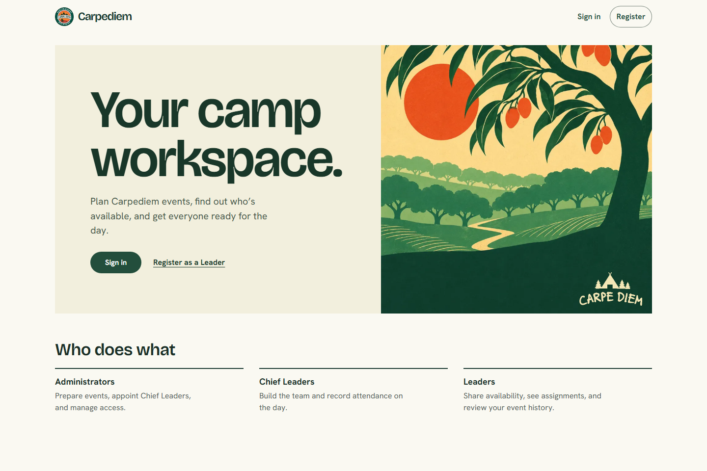

# Carpediem design excellence report

**Carpediem reached 95/100 in independent review, up from 90/100.** The reviewer awarded 10/10 for mobile experience and 15/15 for page composition. The same nine criteria were used throughout. This round covered seven operational routes and carried forward the assessment of the rest of the product. [Independent scorecard and evidence](mobile-records/INDEPENDENT-REVIEW.md)

## What changed

A Leader following a direct availability link now sees the published event, venue, and start and end times in Cairo before choosing a response. On a 390 px phone, both 48 px choices fit on one row about 399 px from the top. If the connection fails during a save, the screen keeps the last confirmed answer and offers a refresh to check what the server recorded. [Phone screenshot](mobile-records/availability-390.png) · [Delayed response and recovery](mobile-records/independent/delayed-response.webm)

The other records now open with what the person came to do. An appointment reads like an invitation with an immediate decision. An assignment opens with a timetable. Feedback starts with the person and five rating choices. Incident reporting keeps the two required fields together and lets the reporter reveal the optional time. [Appointment](mobile-records/appointment-390.png) · [Assignment](mobile-records/assignment-390.png) · [Feedback](mobile-records/event-feedback-390.png) · [Incidents](mobile-records/event-incidents-390.png)

Carpediem opens with an original orchard print beside a direct account action. The campsite's real signature anchors the artwork. The public home, authentication and role workspaces share this visual identity. The operational screens use a quieter set of materials so event names, decisions and people carry the emphasis. Photography remains outside runtime pending reuse clearance. [Public design and asset decisions](public/PUBLIC-DESIGN.md)

The operational dashboard groups events by Cairo date. On desktop, filters remain in a separate index. On a phone, they sit above the schedule. Staffing starts with the people a Chief can select. Attendance puts the current count, roster and saving action within the same mobile workflow. Incident review pairs the original report with its response. Closeout connects the consequences of completing an event directly to the confirmation. [Before and after for every route](PAGE-REVIEW.md)

The shared system includes role-specific navigation, purpose-specific action weights, keyed status marks, quieter input surfaces, visible error states and native confirmation sheets. Local route motion is interruptible. A reduced-motion preference removes the animation and retains the state change. The interactive guide exposes reusable controls, the actual draft editor and account access layout. [Component guide](http://127.0.0.1:4216/design-lab) · [Component audit and motion system](COMPONENTS-AND-MOTION.md)

## Evidence

The reference set covers 27 routes and 28 screen cases. Each case has both a phone and a desktop comparison. Three review rounds each cover the shared components, public experience and highest-priority operational screens. A further independent review covers feedback and closeout. Seven videos document interaction, pending states and committed outcomes. [Screenshots](PAGE-REVIEW.md) · [Recordings, accessibility and performance](VERIFICATION.md)

The production bundle totals 398.79 kB raw and 104.52 kB estimated transfer. The production build, TypeScript, 104 Angular tests, 430 Playwright cases and 184 SQL integration tests passed. The earlier domain run passed 96 tests. Seven record routes passed a fresh responsive check at eight widths. The independent reviewer also checked all seven at 320 px with doubled text. A live SQL rehearsal verified that the direct link displays the stored itinerary after publication and that a draft withholds it. [Verification details](VERIFICATION.md)

## Remaining limitations

- Overnight schedules still take more space on narrow screens, and save errors can occupy several lines. Cancellation and rescheduling retain more conventional layouts. [Reviewer deductions](mobile-records/INDEPENDENT-REVIEW.md)
- The independent review used emulated devices and browser recordings. Human screen-reader use, physical devices in field conditions and production latency remain unverified. There was no blinded side-by-side comparison with competing products.
- Existing rights restrictions cover campsite photographs and footage. The orchard artwork is an original graphical treatment. It does not depict a verified event or participant.
- The replacement API still cannot indicate whether an older cancellation was linked in another session. Authorization and concurrency behavior continue to follow the approved contracts.

The reviewed production build is available in the [local preview](http://127.0.0.1:4225/).
