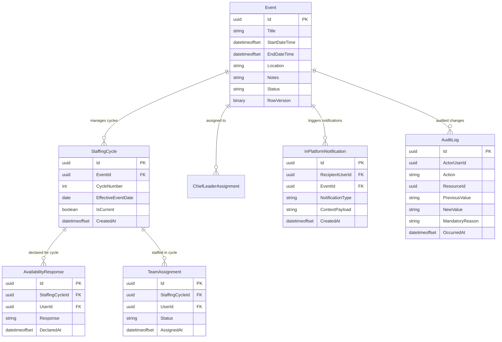
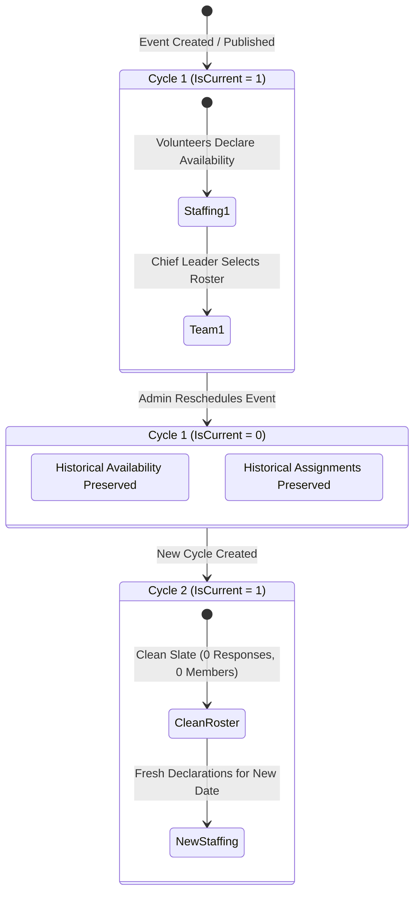

# Data Model: SLICE-12 — Event Reschedule & Staffing Cycle Rotation

**Feature Branch**: `codex/011-event-reschedule-cycle-rotation`  
**Date**: 2026-10-02  

---

## 1. Entity Relationship Overview



---

## 2. State Transition: Staffing Cycle Rotation



---

## 3. Data Transfer Objects & Schemas

### RescheduleEventRequest
```json
{
  "newStartDateTime": "2026-11-15T09:00:00Z",
  "newEndDateTime": "2026-11-15T17:00:00Z",
  "justification": "Venue requested date change due to facility maintenance."
}
```

### RescheduleEventResponse
```json
{
  "eventId": "a1b2c3d4-e5f6-7890-abcd-ef1234567890",
  "title": "Annual Volunteer Summit",
  "status": "Published",
  "startDateTime": "2026-11-15T09:00:00Z",
  "endDateTime": "2026-11-15T17:00:00Z",
  "location": "Main Conference Hall",
  "activeStaffingCycleId": "f9e8d7c6-b5a4-3210-fedc-ba0987654321",
  "cycleNumber": 2,
  "version": "AAAAAAAA+2I=",
  "rescheduledAt": "2026-10-02T12:00:00Z",
  "notificationsDispatched": 4
}
```

### In-Platform Notification Payload (`EventRescheduled`)
```json
{
  "eventTitle": "Annual Volunteer Summit",
  "previousStart": "2026-10-20T09:00:00Z",
  "newStart": "2026-11-15T09:00:00Z",
  "justification": "Venue requested date change due to facility maintenance."
}
```

### Audit Log Record (`EventRescheduled`)
- **ActorUserId**: Guid of the acting Platform Administrator.
- **Action**: `"EventRescheduled"`
- **ResourceType**: `"Event"`
- **ResourceId**: Event Guid.
- **PreviousValue**: `"{PreviousStartDateTime:O}..{PreviousEndDateTime:O}"`
- **NewValue**: `"{NewStartDateTime:O}..{NewEndDateTime:O}"`
- **MandatoryReason**: Admin justification string.
- **Source**: `"AdminReschedule"`
