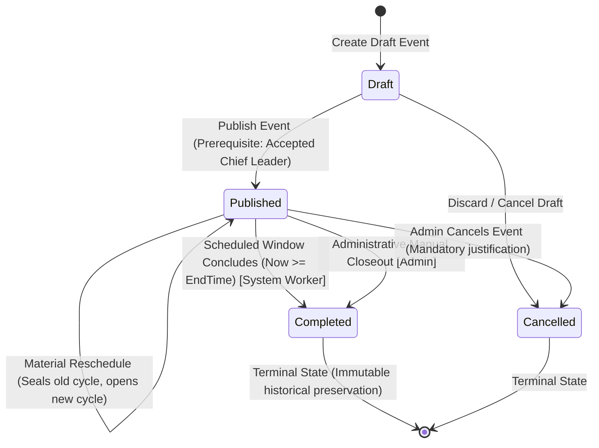

# Data Model & State Transitions: SLICE-14

**Feature**: `SLICE-14: Event Scheduled Completion & Administrative Closeout`  
**Milestone**: M3: Completion, Attendance, Profiling & Dashboards (EPIC-02)  

---

## 1. Lifecycle State Machine: `events.Events`



---

## 2. Entity Model & Invariants

### Aggregate Root: `events.Events`

```csharp
public sealed class Event
{
    public Guid Id { get; private set; }
    public string Title { get; private set; } = string.Empty;
    public EventStatus Status { get; private set; }
    public DateTimeOffset StartDateTime { get; private set; }
    public DateTimeOffset EndDateTime { get; private set; }
    public string Location { get; private set; } = string.Empty;
    public string? Notes { get; private set; }
    public byte[] RowVersion { get; private set; } = [];

    // SLICE-14 Aggregate Mutation:
    public void Complete(DateTimeOffset utcNow, string? actorUserId = null)
    {
        if (Status != EventStatus.Published)
        {
            throw new InvalidEventStatusForCompletionException(
                $"Event {Id} in status '{Status}' cannot be completed. Only 'Published' events may transition to 'Completed'.");
        }

        Status = EventStatus.Completed;
    }
}
```

### Invariants:
1. **Valid Source State**: Only events in `EventStatus.Published` can transition to `Completed`.
2. **Terminal State**: Once in `Completed`, no further status changes are permissible.
3. **Decoupled Staffing & Attendance**: Active `TeamAssignments` remain in `Active` status; `StaffingCycles` remain unchanged (`IsCurrent` is unaffected by event completion); `AttendanceOutcomes` are neither queried nor modified.

---

## 3. Audit Log Model: `audit.AuditLogs`

```csharp
public static AuditLog EventCompleted(
    Guid eventId,
    string? actorUserId,
    DateTimeOffset occurredAt)
{
    return new AuditLog
    {
        Id = Guid.NewGuid(),
        OccurredAt = occurredAt,
        ActorUserId = actorUserId ?? "System.EventLifecycleWorker",
        Action = "EventCompleted",
        EntityName = "Event",
        EntityId = eventId.ToString(),
        PreviousState = "Published",
        NewState = "Completed",
        Details = actorUserId is null 
            ? "Scheduled window concluded; automated system completion executed." 
            : "Operations Administrator completed event via manual closeout.",
    };
}
```

---

## 4. Web API DTO Contracts

### Response DTO: `CompleteEventResponse`

```json
{
  "eventId": "70000000-0000-0000-0000-000000000001",
  "title": "Cairo Tech Summit 2026",
  "status": "Completed",
  "startDateTime": "2026-10-01T09:00:00Z",
  "endDateTime": "2026-10-01T17:00:00Z",
  "location": "New Cairo Convention Center",
  "notes": null,
  "completedAt": "2026-10-01T17:00:00Z",
  "version": "AQIDBAUGCAk="
}
```

### Concurrency Headers:
- Request: `If-Match: "{currentRowVersion}"`
- Response: `ETag: "{newRowVersion}"`
- Replay Response: `Idempotent-Replay: true` (when request replays closeout on an already completed event with identical version).
