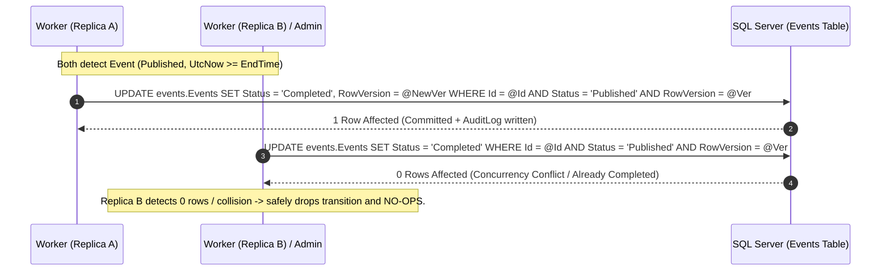

# Technical Research & Architectural Decisions: SLICE-14

**Feature**: `SLICE-14: Event Scheduled Completion & Administrative Closeout`  
**Milestone**: M3: Completion, Attendance, Profiling & Dashboards (EPIC-02)  

---

## 1. Background Worker Mechanics in Modular Monolith (`BackgroundService`)

### Pattern Selection & Scoping
In ASP.NET Core 10, background worker execution is achieved natively via `Microsoft.Extensions.Hosting.BackgroundService`. Per **ADR-007**, no external scheduling frameworks (Hangfire, Quartz) or message queues (RabbitMQ, SQS) are permitted.

```csharp
public sealed class EventLifecycleBackgroundWorker(
    IServiceScopeFactory scopeFactory,
    IOptions<EventLifecycleWorkerOptions> options,
    ILogger<EventLifecycleBackgroundWorker> logger,
    TimeProvider timeProvider) : BackgroundService
{
    protected override async Task ExecuteAsync(CancellationToken stoppingToken)
    {
        while (!stoppingToken.IsCancellationRequested)
        {
            try
            {
                using var scope = scopeFactory.CreateScope();
                var completionStore = scope.ServiceProvider.GetRequiredService<IEventCompletionStore>();
                await completionStore.ProcessScheduledCompletionsAsync(timeProvider.GetUtcNow(), stoppingToken);
            }
            catch (OperationCanceledException) when (stoppingToken.IsCancellationRequested)
            {
                break;
            }
            catch (Exception ex)
            {
                logger.LogError(ex, "Unexpected error in EventLifecycleBackgroundWorker execution loop.");
            }

            await Task.Delay(options.Value.ScanInterval, timeProvider, stoppingToken);
        }
    }
}
```

### Key Lifecycle Principles:
1. **Scoped Store Resolution**: Because `CarpediemDbContext` is scoped per-request, the singleton `BackgroundService` creates a fresh `IServiceScope` per scan tick, preventing memory leaks and stale EF Core tracker state.
2. **Deterministic Time Mocking**: Uses `TimeProvider` (`Microsoft.Extensions.TimeProvider`), allowing unit and integration tests to control simulated time deterministically without altering system clocks.
3. **Graceful Shutdown**: The loop passes `stoppingToken` to all asynchronous operations and exits cleanly upon SIGTERM or application termination.
4. **Configurable Scan Cadence**: Configured via `EventLifecycleWorkerOptions.ScanIntervalSeconds` (default: 30 seconds). In tests, a manual trigger or reduced interval can be injected.

---

## 2. Multi-Replica Concurrency & Race 9 Resolution

In production environments (e.g., AWS ECS/Fargate), multiple container replicas may run the `BackgroundService` simultaneously. Furthermore, an Operations Administrator may trigger manual closeout while a background scan is active.

### Concurrency Vulnerabilities & Solutions



### Safe No-Op Semantics:
1. In `EfEventCompletionStore`, transition execution loads the event with its rowversion and checks `Status == EventStatus.Published`.
2. Inside an execution strategy and atomic transaction:
   - Sets `event.Complete(utcNow, actorUserId)`.
   - Appends `AuditLog.EventCompleted(...)`.
   - Calls `dbContext.SaveChangesAsync()`.
3. If concurrent modification occurs, EF Core throws `DbUpdateConcurrencyException`.
4. For the **Background Worker**: The exception is caught and logged as a transient concurrency collision, safely dropping the transition because another replica (or the Admin) already completed it.
5. For **Admin Closeout**: If the event is already `Completed` and the supplied `If-Match` matches the completed event's current `RowVersion`, returns `200 OK` with header `Idempotent-Replay: true`. If rowversions differ, returns `412 Precondition Failed` (`concurrency_conflict`).

---

## 3. Decoupling from Attendance Recording (`SLICE-15`)

A vital domain invariant is that **Event Completion is decoupled from Attendance Finalization**:
- In the real world, events conclude physically regardless of whether roll call was submitted.
- Requiring attendance before completion would trap unattended events in `Published` status forever if a Chief Leader failed to mark attendance.
- Conversely, requiring completion before attendance would prevent Chief Leaders from taking roll call during the event.
- Therefore:
  - `Event.Complete(...)` does not query or validate `attendance.AttendanceOutcomes`.
  - All existing `staffing.TeamAssignments` remain in `Active` status.
  - If any active team assignments have unrecorded attendance post-completion, this is dynamically projected in `SLICE-19` as the derived operational condition **`Pending Attendance`**.

---

## 4. Observability & OpenTelemetry Instrumentation

A dedicated telemetry component `EventCompletionTelemetry` registers an `ActivitySource` and `Meter` (`Carpediem.Events.Completion`):
- **Metrics**:
  - `events.completion.worker.scans` (Counter: total background worker scans executed)
  - `events.completion.worker.completed` (Counter: events transitioned to Completed by worker)
  - `events.completion.admin.completed` (Counter: events transitioned via Admin manual closeout)
  - `events.completion.concurrency_conflicts` (Counter: concurrent collision no-ops)
- **Activities**:
  - Trace `ProcessScheduledCompletions`
  - Trace `ManualCloseout`
